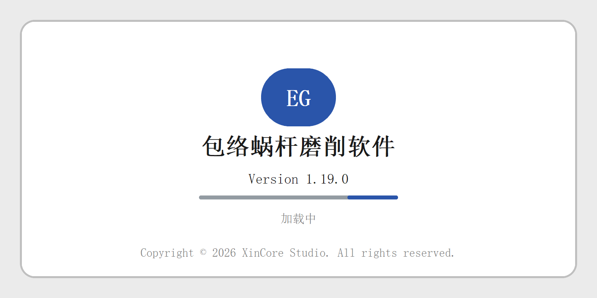

# 第 1 章：快速开始

本章带您完成 **EnveloGrinding** 的安装部署、授权激活、主界面认识以及一次完整的三分钟端到端演练。

## 本章导读

| 节次 | 主题 | 您将掌握 |
| :---: | :--- | :--- |
| **1.1** | **[软件安装、授权与升级](installation.md)** | Windows / macOS 安装方式、3 种登录授权激活方式、在线检查更新与更新日志 |
| **1.2** | **[界面布局与基本操作](ui_overview.md)** | 顶部菜单、3 大主选项卡 × 9 子页面、条件参数显隐、绿色微调框与悬停提示 |
| **1.3** | **[三分钟快速上手](quickstart.md)** | 以真实脱敏零件 `Sample_C_117` 串联“零件库 → 砂轮截形 → 轴向截面 → NC 代码” |

## 启动流程一览

1. 双击桌面图标启动软件，弹出启动画面并自动在后台检测加密狗与本地离线授权。

2. 若未插入加密狗，软件进入 **登录** 窗口，可通过 **`硬件ID`**、**`账户登录`** 或 **`加密狗`** 任一方式验证后进入主界面；若已插入有效加密狗，将自动跳过登录画面直接进入主窗口。
