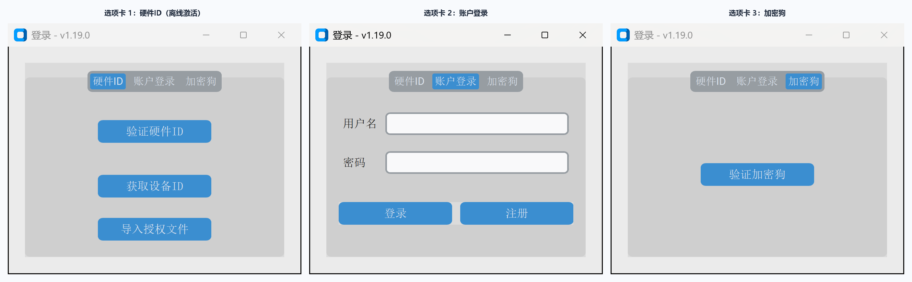
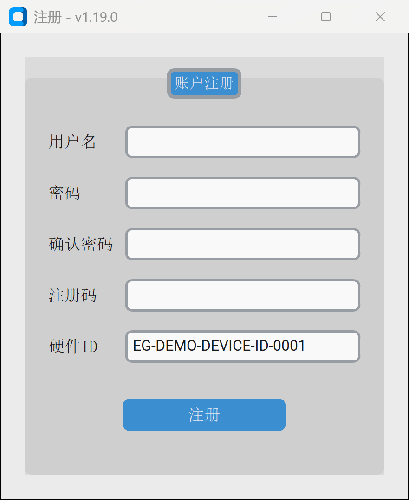
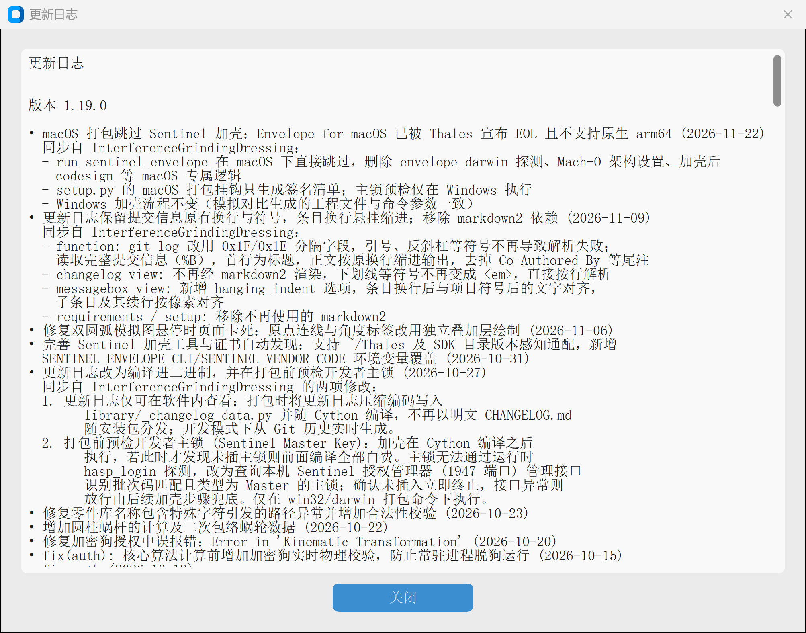

# 1.1 软件安装、授权与升级

## 一、软件安装

购买软件后联系技术支持获取对应平台安装包：

- **Windows（64 位）**：运行 `.exe` 安装向导并按提示完成安装，通过桌面或开始菜单快捷方式启动。
- **macOS**：打开 `.dmg` 镜像，将 **EnveloGrinding** 图标拖入“应用程序”文件夹后双击启动。

> **平台功能差异提示**：**`Siemens程序加密`** 依赖 Windows 专用加密组件，仅在 Windows 版本中可用；macOS 版本中该复选框默认禁用。

---

## 二、三种授权激活方式

未检测到即插即用加密狗时，启动后进入 **`登录`** 窗口，顶部提供三个选项卡：

### 方式 1：硬件ID（推荐离线生产机使用）

适用于无外网环境的车间电脑或固定工作站，提供两种离线激活路径：

1. **云端绑定硬件码**：
   - 点击 **`获取设备ID`** 查看本机唯一硬件特征码并发送给技术支持；
   - 后台完成授权绑定后，联网点击一次 **`验证硬件ID`**，通过后即可长期离线使用。
2. **离线许可文件（`.lic`）导入**：
   - 若设备完全断网，将本机硬件特征码发给技术支持签发 `eg_license.lic`；
   - 点击 **`导入授权文件`** 选择该 `.lic` 文件，验签通过后即刻激活本机永久离线授权并自动进入主界面。

### 方式 2：账户登录与注册

适用于需要联网使用个人账号的场景（账号已与注册时绑定的设备硬件 ID 强绑定）：

1. 在 **`账户登录`** 选项卡输入 **`用户名`** 与 **`密码`**，点击 **`登录`**（需保持联网）。
2. 若尚未注册账号，点击右下角 **`注册`** 打开 **`注册`** 窗口：

3. 在 **`账户注册`** 选项卡依次填写：
   - **`用户名`**：自定义登录账号；
   - **`密码`** 与 **`确认密码`**：两次输入需完全一致；
   - **`注册码`**：向技术支持申请的专用注册码；
   - **`硬件ID`**：默认自动读取本机 ID，请勿随意修改，点击 **`注册`** 提交完成。

### 方式 3：加密狗（即插即用与实时监控）

1. 将已授权的 Sentinel 硬件加密狗插入电脑 USB 接口。
2. **自动免登录**：启动软件时检测到有效加密狗，将直接跳过登录窗口进入主界面，并在主窗口底部显示 **`🟢 加密狗授权已激活`**。
3. **手动验证**：若在登录界面出现后才插入加密狗，可切换到 **`加密狗`** 选项卡点击 **`验证加密狗`**。
4. **安全与断狗保护**：软件每 3 秒自动校验加密狗在线状态并在核心计算前二次验签；使用过程中拔出加密狗将触发保护并自动关闭程序。

---

## 三、在线升级与更新日志

1. **检查更新**：点击顶部菜单 **`设置` $\rightarrow$ `检查更新`**，软件自动向服务器查询最新版本。若发现新版本，确认后自动下载安装包（实时显示下载速度与百分比进度）并引导安装。
2. **查看更新日志**：点击顶部菜单 **`设置` $\rightarrow$ `更新日志`**，可浏览从历史版本至当前 `v1.19.0` 的全部功能新增与问题修复记录：

