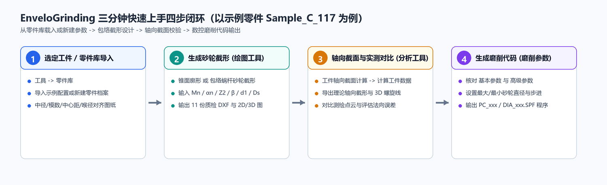

# 1.3 三分钟快速上手

本节使用脱敏真实零件 **`Sample_C_117`**（大压力角渐开线包络蜗杆），带您走通从**载入零件 → 砂轮截形计算 → 理论轴向截面校验 → 批量生成 CNC 磨削代码**的四步完整闭环。

---

## 第一步：从零件库载入或核对工件参数

1. 启动软件，点击顶部菜单 **`工具` $\rightarrow$ `零件库`**。
2. 选中示例零件 **`Sample_C_117`**（配置详情显示 `116.921 / 38.5 / 60`），点击右下角绿色 **`导入`** 按钮并确认。
3. 导入后，全软件三大选项卡参数已自动就绪：
   - **`中心距`**：`116.921` mm
   - **`蜗杆喉部直径`**：`38.5` mm
   - **`蜗轮齿数`**：`60`
   - **`法向模数 Mn` / `法向压力角 αn (°)` / `螺旋角 β (°)`**：`3.25` mm / `23.5` ° / `3.393` °

---

## 第二步：生成砂轮截形（`绘图工具`）

### 路径 A：快速生成规则 `锥面廓形`

1. 切换到 **`绘图工具` $\rightarrow$ `锥面廓形`**。
2. 核对参数：**`中径宽`** `4.78`、**`中径齿顶高`** `3.02`、**`中径齿底高`** `2.23`、**`齿型右半角`** `23.5`、**`齿型左半角`** `23.5`。
3. 在 **`保存文件`** 指定输出路径（如 `D:\EG_Demo\Sample_C_117\conical_23.5.dxf`），点击 **`生成齿形文件`**。
4. 软件同步生成 `conical_23.5.dxf` 与同目录 `conical_23.5.html`（可双击用浏览器查看交互齿形）。

### 路径 B：计算高精度 `包络蜗杆砂轮截形`

1. 切换到 **`绘图工具` $\rightarrow$ `包络蜗杆砂轮截形`**。
2. 确认 **`齿轮齿面类型 = 渐开线齿轮`**、**`砂轮外径 Ds = 460.0`** mm、**`参与啮合齿数 = 7`**、**`修整延长齿高 = 5.0`** mm。
3. 指定 **`保存文件`**（如 `D:\EG_Demo\Sample_C_117\wheel_23.5.dxf`），点击 **`生成截形`**。
4. 稍候片刻即可获得主截形 DXF、2D/3D 交互 HTML 以及 `_01` ~ `_11` 全套质检 DXF。

---

## 第三步：核对工件数据与轴向截面（`分析工具`）

1. 切换到 **`分析工具` $\rightarrow$ `工件轴向截面计算`**。
2. 确认 **`中心距`** `116.921`、**`蜗杆喉部直径`** `38.5`、**`蜗轮齿数`** `60`、**`砂轮安装倾角`** `3.393`、**`砂轮直径`** `460.0`、**`砂轮分度圆齿顶高`** `3.02`、**`蜗杆计算齿数`** `7`。
3. 点击绿色 **`计算工件数据`** 按钮，核对理论传动比 `60.0`、端面模数 `3.2557`、标准导程角 `4.8336°` 等指标。
4. 在 **`齿型文件地址`** 选入上一步生成的 `conical_23.5.dxf`，在 **`保存文件`** 指定 `axial_section.dxf`，点击 **`生成工件截面曲线`**，生成 2D 轴向截面图与 3D 喉部螺旋曲线图。

---

## 第四步：生成 CNC 数控磨削程序（`磨削参数`）

1. 切换回 **`磨削参数` $\rightarrow$ `基本参数`**。
2. 核对 **`蜗杆类型 = 锥面`**、**`蜗杆旋向 = 右旋`**、**`磨削方向 = 从右往左`**、**`磨削总深度 = 1.0`**、**`磨削步进 = 0.1`**，并将砂轮直径范围设为 **`最大砂轮直径 = 460.0`**、**`最小砂轮直径 = 450.0`**、**`砂轮直径间隔 = 2.0`**。
3. 在 **`输出程序路径`** 选择目标文件夹（如 `D:\EG_Demo\NC_Output`），确认 **`高级参数`** 中的机床几何与对刀基准无误后，点击 **`生成代码`**。
4. 软件自动生成文件夹 `PC_116_9210`，内含 **`DIA_450_0000.SPF` ~ `DIA_460_0000.SPF`** 共 6 份加工程序，可直接拷贝至西门子数控磨床按实际砂轮直径调用！
