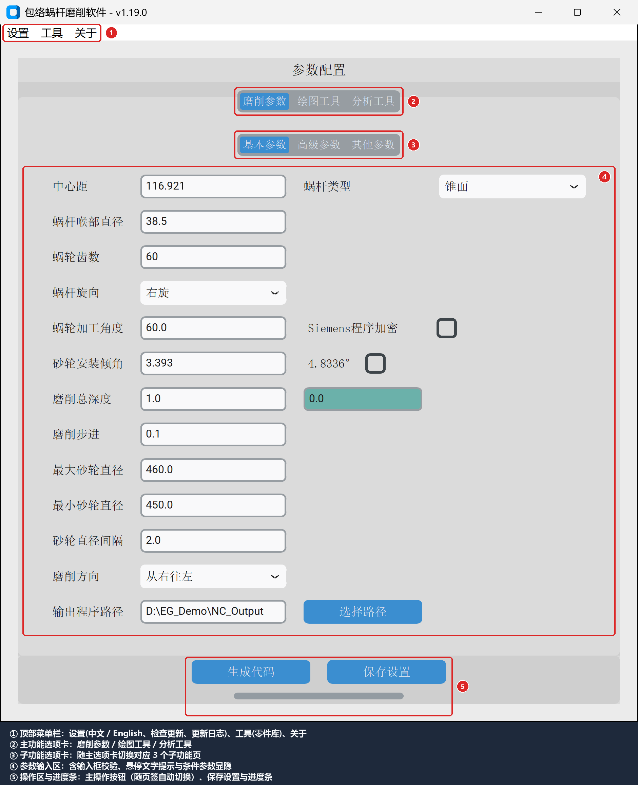

# 1.2 界面布局与基本操作

**EnveloGrinding** 采用紧凑的**分层选项卡 + 统一操作底栏**设计，所有配置在修改并触发计算或点击 **`保存设置`** 后自动持久化到本地 JSON 文件。

---

## 一、五大界面分区速查

| 编号与区域 | 组成与核心职责 |
| :---: | :--- |
| **① 顶部菜单栏** | 包含三大菜单： • **`设置`**：语言切换（**`中文`** / **`English`**）、**`检查更新`**、**`更新日志`**； • **`工具`**：**`零件库`**（工件参数归档与一键导入）； • **`关于`**：**`官方网站`**、**`用户手册`**、**`关于我们`**。 |
| **② 主功能选项卡** | 切换软件三大核心工作区： • **`磨削参数`**：配置工件/机床几何并生成 CNC `.SPF`（或 `.cpf`）磨削程序； • **`绘图工具`**：绘制 **`锥面廓形`**、转换 **`XY点位文件`**、仿真 **`包络蜗杆砂轮截形`**； • **`分析工具`**：执行 **`工件轴向截面计算`**、**`DXF 文件对比`** 与 **`曲线误差对比`**。 |
| **③ 子功能选项卡** | 随上方主选项卡自动切换对应 3 个子页面（全软件共 **3 × 3 = 9 个子功能页**）。 |
| **④ 参数输入区** | 承载当前子页面所有输入控件、下拉选项、复选框与文件路径选择器；部分页面支持平滑滚动。 |
| **⑤ 底部操作区与进度条** | • **左侧动态主按钮**：随当前激活的子页自动变换文案（`生成代码` / `生成齿形文件` / `生成截形` / `生成工件截面曲线` / `生成对比 DXF` / `生成误差对比数据`）； • **右侧 `保存设置`**：一键校验并保存当前所有页签参数； • **底部进度条**：在多进程/后台计算期间自动播放进度动画，完成后自动弹窗并定位输出文件夹。 |

---

## 二、九大子功能页索引

| 主选项卡 | 子选项卡名称 | 底部主按钮 | 产出文件类型 |
| :--- | :--- | :--- | :--- |
| **`磨削参数`** | **`基本参数`** / **`高级参数`** / **`其他参数`** | **`生成代码`** | `PC_xxx/DIA_xxx.SPF`（加密后为 `.cpf`） |
| **`绘图工具`** | **`锥面廓形`** | **`生成齿形文件`** | `.dxf` 齿形 + 2D 交互 `.html` |
| **`绘图工具`** | **`XY点位文件`** | **`生成齿形文件`** | `.dxf` 点云曲线 + 2D 交互 `.html` |
| **`绘图工具`** | **`包络蜗杆砂轮截形`** | **`生成截形`** | 主截形 `.dxf` + 2D/3D `.html` + 11 份质检 `.dxf` |
| **`分析工具`** | **`工件轴向截面计算`** | **`生成工件截面曲线`** | 轴向截形 `.dxf` + 2D/3D `.html`（另有 **`计算工件数据`** 弹窗） |
| **`分析工具`** | **`DXF 文件对比`** | **`生成对比 DXF`** | 叠加 `.dxf` + 2D 交互 `.html` |
| **`分析工具`** | **`曲线误差对比`** | **`生成误差对比数据`** | `*-differences.dxf` + 差值/叠加 `.html` |

---

## 三、高效交互机制

1. **输入合法性实时拦截**：数值框自动拦截非法字符（如正实数、负号允许范围、整数齿数、`0~99` 两位 **`XY 数据索引号`**、`-180°~180°` 角度范围等）。
2. **条件参数自动显隐**：在 **`基本参数`** 与 **`工件轴向截面计算`** 中切换 **`蜗杆类型`**（`平面` / `锥面`）时，仅在选 **`平面`** 时展开偏移角/偏移距离等专属项，选 **`锥面`** 时自动隐藏。
3. **绿色微调补偿框**：**`磨削总深度`**、**`高级参数`** 全部 9 项以及 **`锥面廓形`** 左右半角右侧均带有**绿色输入框**，专门用于现场试磨后的实测微调补偿（直接与左侧主参数叠加生效，无需覆盖原始图纸值）。
4. **互斥参数灰显提示**：在 **`包络蜗杆砂轮截形`** 中，填入 **`蜗杆法向齿厚中值 Sn`** 时自动禁用 **`刀具变位系数 x`**；填入 **`蜗杆齿顶高 ha`** 与 **`蜗杆全齿高 h`** 时自动禁用标准系数 **`ha*`** 与 **`c*`**。
5. **悬停说明提示卡片**：将鼠标停留在 **`包络蜗杆砂轮截形`**、**`XY 数据索引号`** 或 **`交换 XY 数据`** 等控件上，自动弹出详细中文物理含义与工艺影响说明；移开鼠标或点击输入即自动收起。
6. **多进程防卡顿与自动定位输出**：核心几何仿真与代码生成在后台进程池执行，完成后自动打开资源管理器并高亮选中生成的文件夹或文件。
