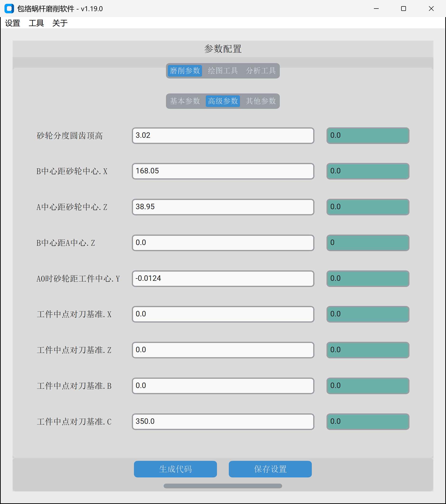
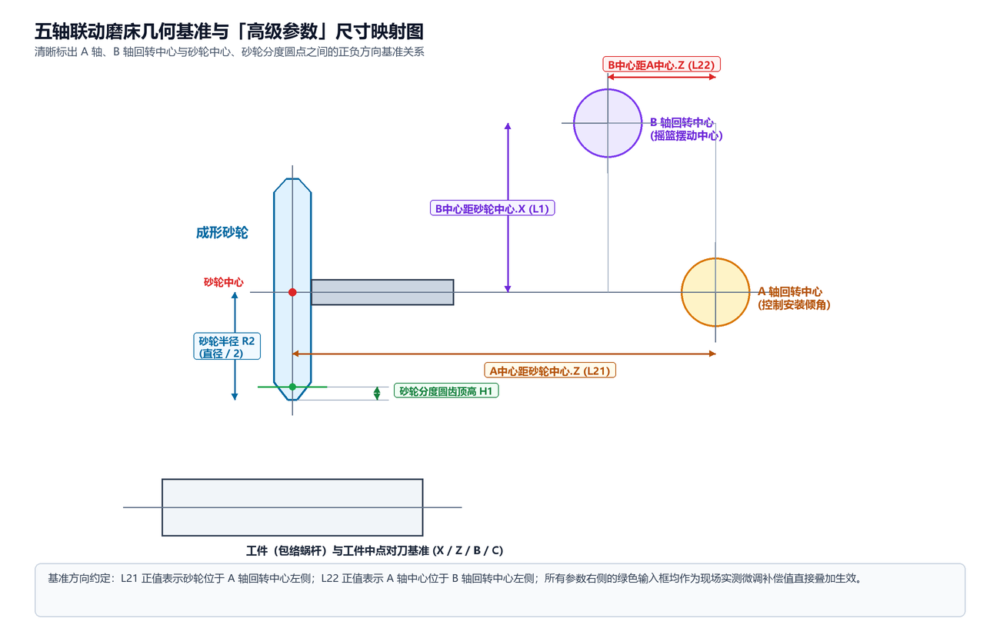

# 2.2 高级参数（机床基准与对刀）

**`高级参数`** 共有 **9 项核心几何与对刀参数**，描述砂轮外沿、五轴机床 `A / B` 轴回转中心相对关系以及实际对刀点基准坐标。

> **实测微调说明**：每项右侧的**绿色输入框**均会在计算时直接与左侧主值相加，用于现场试磨后的微调补偿，无需覆写原机械出厂标定值。

---

## 一、五轴机床几何基准示意图

---

## 二、9 项参数逐项详解

| 序号 | 软件参数名称 | 示例值 (`Sample_C_117`) | 含义与方向约定 |
| :---: | :--- | :---: | :--- |
| **1** | **`砂轮分度圆齿顶高`** | `3.02` mm | 砂轮齿廓理论分度圆到齿顶（外缘）的径向高度 $H_1$。**必须与砂轮实际修整尺寸（`锥面廓形` 中的 `中径齿顶高`）一致**。 |
| **2** | **`B中心距砂轮中心.X`** | `168.05` mm | 机床 `B` 轴回转中心到砂轮主轴中心在 `X` 轴方向上的距离 $L_1$。 |
| **3** | **`A中心距砂轮中心.Z`** | `38.95` mm | 机床 `A` 轴回转中心到砂轮中心在 `Z` 轴方向上的距离 $L_{21}$；**正值表示砂轮位于 `A` 轴回转中心左侧**。 |
| **4** | **`B中心距A中心.Z`** | `0.0` mm | 机床 `B` 轴回转中心到 `A` 轴回转中心在 `Z` 轴方向上的距离 $L_{22}$；**正值表示 `A` 轴中心位于 `B` 轴中心左侧**。 |
| **5** | **`A0时砂轮距工件中心.Y`** | `-0.0124` mm | 当 `A = 0°` 时，砂轮中心与工件中心在 `Y` 轴方向的标定基准偏差 $a_{0Y}$；用于计算最终输出的 `Y轴加工位置`。 |
| **6** | **`工件中点对刀基准.X`** | `0.0` mm | 手动对刀将砂轮分度圆基准点对准工件喉部理论中点时，机床 `X` 轴坐标 $X_0$。 |
| **7** | **`工件中点对刀基准.Z`** | `0.0` mm | 同上，对刀时刻的机床 `Z` 轴坐标 $Z_0$。 |
| **8** | **`工件中点对刀基准.B`** | `0.0` ° | 同上，对刀时刻的 `B` 轴绝对角度 $B_0$。 |
| **9** | **`工件中点对刀基准.C`** | `350.0` ° | 同上，对刀时刻的工件主轴 `C` 轴起始相位角 $C_0$（多齿分度或槽位对准时尤为关键）。 |

---

## 三、核心几何换算关系

软件依据上述 9 项参数计算实际插补基准：

1. **合成 `B` 轴与砂轮分度圆虚拟半径**：
   - $L_2 = L_{21}\cdot \cos(\text{安装角}) + L_{22}$（`平面` 模式加工右侧时 $L_{22}$ 自动取反）；
   - $L_3 = L_1 + R_2 - H_1$（其中 $R_2 = \text{当前砂轮直径} / 2$）；
   - $R_3 = \sqrt{L_3^2 + L_2^2}$。
2. **`Y` 轴加工高度**：
   - $\text{Ypos} = a_{0Y} - \sin(\text{实际倾角}) \cdot L_{21} \cdot \text{旋向符号}$。
3. **包络圆弧拟合**：
   - 软件由磨削起点 $(X_4, Z_4)$、中点 $(X_0, Z_0)$ 与终点 $(X_8, Z_8)$ 三点求解基准圆心 `(Center_Pos_X, Center_Pos_Z)` 与圆弧半径 `Center_R`，供西门子主循环调用。
