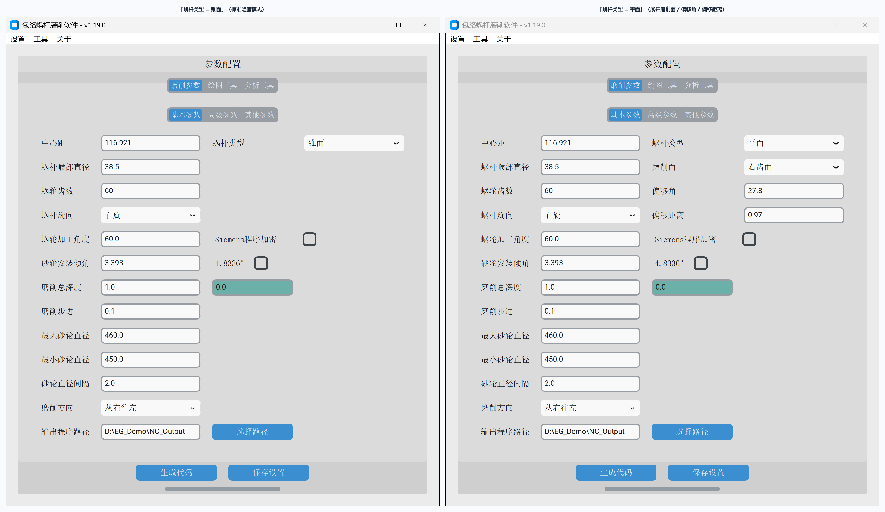
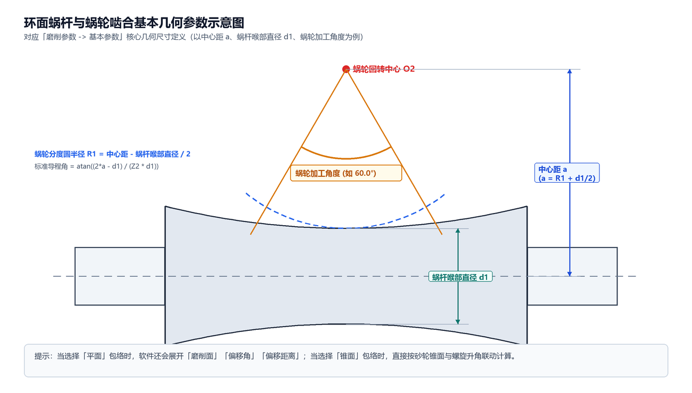

# 2.1 基本参数详解

**`基本参数`** 集中管理工件基础几何、砂轮直径序列、磨削进给策略以及 **`平面`** / **`锥面`** 包络模式切换。

---

## 一、工件与轨迹几何参数

### 1. 中心距

- **单位**：$\text{mm}$ ｜ **示例值（`Sample_C_117`）**：`116.921`
- **含义**：蜗杆轴线与配对蜗轮回转轴线之间的最短垂直距离 $a$。
- **影响**：与 **`蜗杆喉部直径`** 共同决定蜗轮分度圆半径 $R_1 = a - d_1 / 2$，直接作为输出目录 `PC_<中心距>` 的命名依据。

### 2. 蜗杆喉部直径

- **单位**：$\text{mm}$ ｜ **示例值（`Sample_C_117`）**：`38.5`
- **含义**：环面蜗杆中间最细咽喉处分度圆直径 $d_1$。
- **影响**：与 **`中心距`**、**`蜗轮齿数`** 联动实时计算右侧的标准喉部分度圆导程角。

### 3. 蜗轮齿数

- **单位**：整数（齿） ｜ **示例值（`Sample_C_117`）**：`60`
- **含义**：配对蜗轮的牙齿总数量 $Z_2$。
- **影响**：决定传动比与摇篮摆动时 `C` 轴相对 `B` 轴的联动增量转角（$\Delta C = \mp \text{sgn}(h_N)\cdot \alpha_1 / (360 / N_1) \times 360^\circ$）。

### 4. 蜗杆旋向

- **可选项**：`右旋`（默认） / `左旋`
- **含义**：沿蜗杆轴线观察螺旋线的前进方向。
- **影响**：决定加工时工件主轴 `C` 轴旋转方向及 `A` 轴倾角偏置符号。

### 5. 蜗轮加工角度

- **单位**：`°`（度） ｜ **示例值（`Sample_C_117`）**：`60.0`
- **含义**：砂轮在磨削包络运动中相对蜗轮回转中心摆动的总包络角度 $\alpha_1$（对应 `B` 轴从 $B_0 + \alpha_1/2$ 摆到 $B_0 - \alpha_1/2$）。
- **影响**：必须完整覆盖蜗杆有效工作齿数对应的包络弧段并适当留出切入/切出余量。

### 6. 砂轮安装倾角

- **单位**：`°`（度） ｜ **示例值（`Sample_C_117`）**：`3.393`
- **含义**：砂轮主轴相对工件端面倾斜安装的角度（通常取图纸导程角或螺旋角）。
- **便捷功能**：输入框右侧实时显示按标准公式算出的喉部分度圆导程角（如 `Sample_C_117` 处显示 `4.8336°`）；勾选右侧复选框即可一键将计算结果填入 **`砂轮安装倾角`**。

---

## 二、包络类型与条件展开参数

### 7. 蜗杆类型

- **可选项**：`平面` / `锥面`
- **动态界面行为**：
  - 选 **`锥面`** 时：适用于砂轮双侧锥面或渐开线包络砂轮加工，右侧自动隐藏 **`磨削面`**、**`偏移角`**、**`偏移距离`**；
  - 选 **`平面`** 时：适用于平面二次包络环面蜗杆单面切向磨削，自动展开以下 **3 项专属参数**。

### 8. 磨削面（仅 `平面` 可见）

- **可选项**：`左齿面` / `右齿面`
- **含义**：指定当前生成程序所磨削的环面蜗杆齿面侧别（`右齿面` 加工时程序自动将安装角转向 $+180^\circ$ 侧并反号偏置 `B` 轴中点）。

### 9. 偏移角（仅 `平面` 可见）

- **单位**：`°`（度）
- **含义**：平面包络产形平面相对基准半径线的偏移倾角。

### 10. 偏移距离（仅 `平面` 可见）

- **单位**：$\text{mm}$
- **含义**：平面包络产形平面相对回转中心的法向偏移距离（会在生成的 `.SPF` 文件头自动输出计算后的 `砂轮Z向偏移量` 与 `砂轮X向偏移量`）。

---

## 三、磨削余量、砂轮范围与输出设置

### 11. 磨削总深度（带右侧绿色微调框）

- **单位**：$\text{mm}$ ｜ **示例值**：主框 `1.0`、右侧绿色微调框 `0.0`
- **含义**：从 `FeedLeft` 最大值到 `0.00` 的余量分段覆盖范围；若 `磨削总深度` 不是 **`磨削步进`** 的整数倍，软件会自动向上取整到步进整数倍。
- **绿色微调框**：用于在不改动程序跳转标签的前提下，整体多磨或少磨一定深度以微调最终齿厚（实际计算半径 $R_{1,\text{cur}} = R_1 - (\text{val} + \text{微调值})$）。

### 12. 磨削步进

- **单位**：$\text{mm}$ ｜ **示例值**：`0.1`
- **含义**：程序内相邻 `CV_x_xx` 余量分支之间的步长（例如 `1.0` 总深度配 `0.1` 步进将生成 `CV_1_00` 至 `CV_0_00` 共 11 个坐标段）。

### 13. 最大砂轮直径 / 最小砂轮直径 / 砂轮直径间隔

- **单位**：$\text{mm}$ ｜ **示例值（`Sample_C_117`）**：`460.0` / `450.0` / `2.0`
- **约束**：**`最大砂轮直径`** 必须大于等于 **`最小砂轮直径`**，否则弹窗报错。
- **生成逻辑**：软件从 **`最小砂轮直径`** 起每隔 **`砂轮直径间隔`** 递增至 **`最大砂轮直径`**，为每个直径生成独立 `.SPF` 文件（如 `DIA_450_0000.SPF` ~ `DIA_460_0000.SPF`）。

### 14. 磨削方向

- **可选项**：`从左往右` / `从右往左`
- **含义**：控制砂轮沿蜗杆轴向走刀的起终点顺序（互换 `Start_Pos` 与 `End_Pos` 及对应 `B` / `C` 轴起止点），用于匹配顺磨或逆磨工况。

### 15. Siemens程序加密

- **选项**：复选框（默认不勾选）
- **平台限制**：**仅 Windows 版可用**（macOS 下自动置灰禁用）。
- **效果**：勾选后调用内置加密组件将明文 `.SPF` 转换为西门子机床专用的 `.cpf` 加密程序，并自动删除原始 `.SPF`。

### 16. 输出程序路径

- **操作**：点击 **`选择路径`** 指定根目录（例如 `D:\EG_Demo\NC_Output`）。
- **输出位置**：软件会在该目录下自动重建 `PC_<中心距>` 文件夹（4 位小数下划线拼接，如 `PC_116_9210`）并存入全部程序。
