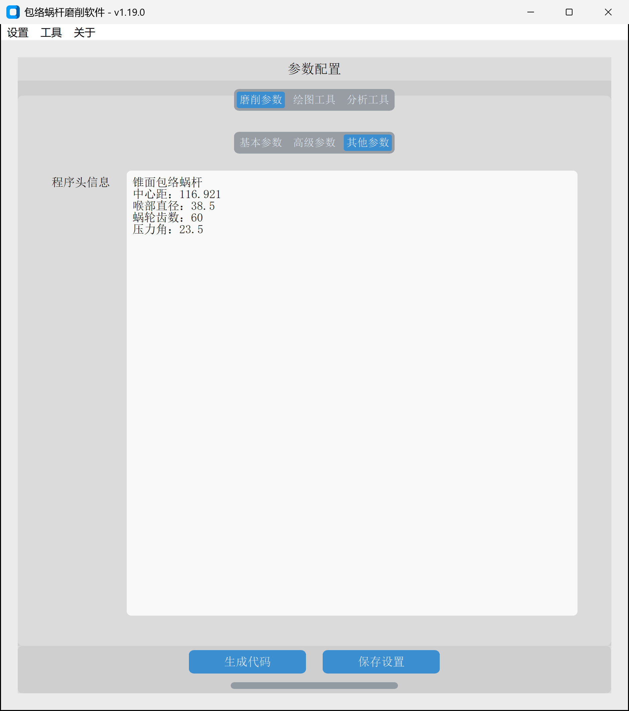

# 2.3 其他参数与 NC 程序输出解读

## 一、其他参数：`程序头信息`

切换到 **`磨削参数` $\rightarrow$ `其他参数`**，可在文本框中输入任意多行备注（如蜗杆图号、中心距、喉径、齿数、压力角等）。



- **自动注释化**：生成程序时，软件会自动在每一行前添加西门子注释符 `;`，置于 `;********头信息*********` 区块之下，既方便操作员机台核对，又不影响 CNC 运行。

---

## 二、输出目录结构与文件命名

点击 **`生成代码`** 后，软件在 **`输出程序路径`** 下创建 `PC_<中心距>` 文件夹（4 位小数中的 `.` 替换为 `_`）：

```text
D:\EG_Demo\NC_Output\
└── PC_116_9210\
    ├── DIA_450_0000.SPF
    ├── DIA_452_0000.SPF
    ├── DIA_454_0000.SPF
    ├── DIA_456_0000.SPF
    ├── DIA_458_0000.SPF
    └── DIA_460_0000.SPF
```

- **单文件对应单直径**：文件名 `DIA_460_0000` 表示该程序针对当前实测直径为 `460.0000 mm` 的砂轮计算。
- **砂轮修整换用原则**：车间每修整减小一定砂轮直径后，直接调用最接近当前直径的 `DIA_xxx.SPF`（或 `.cpf`）子程序即可自动补偿包络半径变化。
- **西门子加密输出**：若勾选了 **`Siemens程序加密`**，同目录内会直接生成 `.cpf` 加密文件，明文 `.SPF` 将被自动移除。

---

## 三、真实 `.SPF` 程序片段解读（`Sample_C_117`）

以下为软件用 `Sample_C_117` 参数真实生成的 `DIA_460_0000.SPF` 开头部分：

```text
;********头信息*********
;锥面包络蜗杆
;中心距：116.921
;喉部直径：38.5
;蜗轮齿数：60
;压力角：23.5
;*****版本及日期*********
;软件版本:1.19.0
;生成日期:2026-11-24 09:47:57
;*****加工参数***********
;蜗杆类型:       锥面;
;涡轮分度圆半径: 97.6710mm;
;涡轮加工角度:   60.0000度;
;涡轮齿数:       60齿;
;蜗杆螺旋角度:   3.3930度;
;蜗杆旋向:       右旋;
;磨削方向:       从右往左;
;砂轮直径:       460.0000mm;
;分度圆齿顶高:   3.0200mm;
;磨削余量:       1.0mm;
;磨削尺寸调整:   0.0mm;
;*****输出数据***********
;Y轴加工位置:    -2.3176;
;*****外部全局变量*********
;FeedLeft     - 剩余磨削量
;Center_Pos_X - 基准圆心坐标.X
;Center_Pos_Z - 基准圆心坐标.Z
;Center_R     - 基准圆圆弧半径
;Start_Pos_X  - 磨削起点坐标.X
;Start_Pos_Z  - 磨削起点坐标.Z
;Start_Pos_B  - 磨削起点角度.B - 绝对坐标
;Start_Pos_C  - 磨削起点角度.C - 绝对坐标
;End_Pos_X    - 磨削终点坐标.X
;End_Pos_Z    - 磨削终点坐标.Z
;End_Pos_B    - 磨削终点角度.B - 绝对坐标
;End_Pos_C    - 磨削终点角度.C - 增量角度
;****************
DEF REAL currentValue;
STOPRE;
currentValue = FeedLeft;

IF (currentValue>=1.00) GOTOF CV_1_00;
IF (currentValue<1.00) AND (currentValue>=0.90) GOTOF CV_0_90;
...
IF (currentValue<0.10) AND (currentValue>=0.00) GOTOF CV_0_00;
IF (currentValue<0) GOTOF CV_0_00;

CV_1_00:
;基准圆心坐标
Center_Pos_X= -298.3590        ;X坐标
Center_Pos_Z=  -38.8817        ;Z坐标
Center_R=      300.8818        ;圆弧半径
;============
;磨削起点坐标
Start_Pos_X=  -20.5317        ;X坐标
Start_Pos_Z= -154.3887        ;Z坐标
Start_Pos_B=  -30.0000        ;B绝对角度
Start_Pos_C=  350.0000        ;C绝对角度
;============
;磨削终点坐标
End_Pos_X=  -59.4134          ;X坐标
End_Pos_Z=  143.9703          ;Z坐标
End_Pos_B=   30.0000          ;B绝对角度
End_Pos_C= 3600.0000          ;C轴终端增量角度
RET
```

---

## 四、外部全局变量速查表

机床主程序通过读取 `FeedLeft` 自动跳入对应 `CV_x_xx` 标签，并接收以下全局变量完成四轴包络运动：

| 变量名 | 坐标/轴向类型 | 物理含义 |
| :--- | :---: | :--- |
| `FeedLeft` | 外部传入余量 | 机床当前剩余磨削深度（决定执行哪一段 `CV_*`） |
| `Center_Pos_X` / `Center_Pos_Z` | 圆弧基准中心 | 包络圆弧中心 `X` / `Z` 坐标 |
| `Center_R` | 圆弧半径 | 三点拟合的包络基准圆弧半径 |
| `Start_Pos_X` / `Start_Pos_Z` | 磨削起点线性轴 | 磨削起点 `X` / `Z` 坐标 |
| `Start_Pos_B` / `Start_Pos_C` | 磨削起点旋转轴 | 磨削起点 `B` 轴、`C` 轴**绝对角度** |
| `End_Pos_X` / `End_Pos_Z` | 磨削终点线性轴 | 磨削终点 `X` / `Z` 坐标 |
| `End_Pos_B` | 磨削终点摆角 | 磨削终点 `B` 轴**绝对角度** |
| `End_Pos_C` | 磨削终点转角 | `C` 轴相对起点的**增量角度**（例：`60` 齿扫 `60°` 时为 `±3600.0000°`） |
