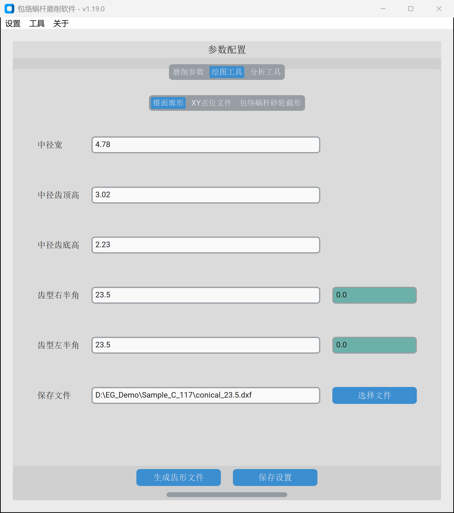
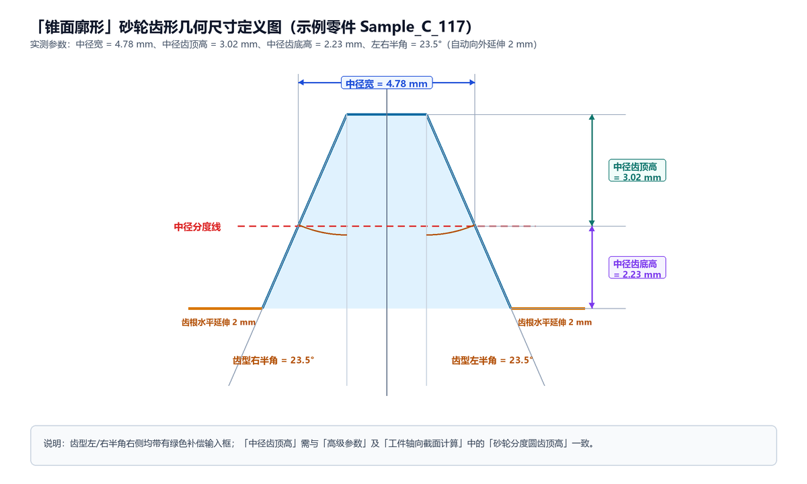
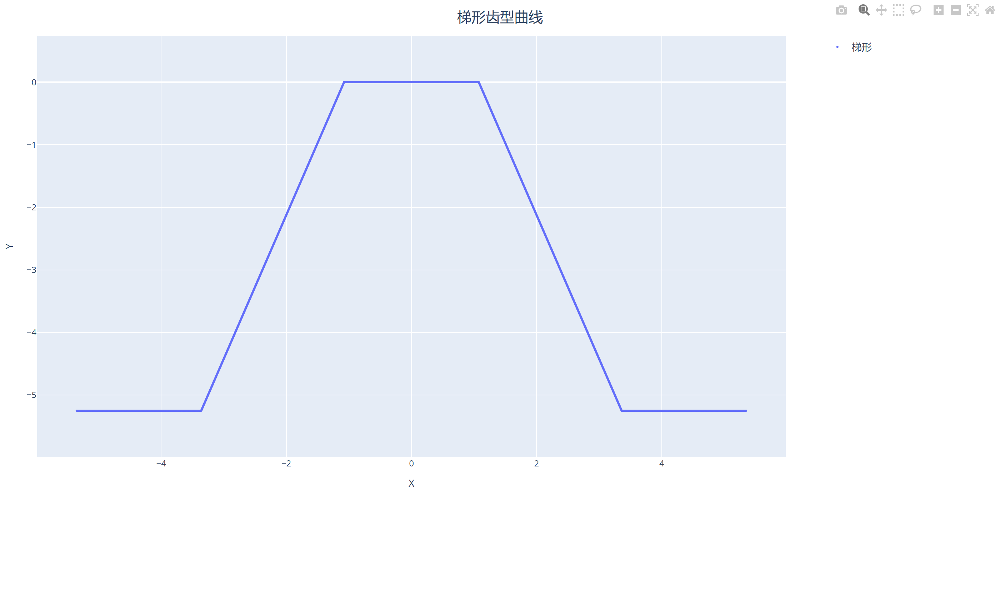

# 3.1 锥面廓形

**`锥面廓形`** 用于快速生成直边对称或不对称梯形砂轮齿廓，输出 1:1 的 CAD `.dxf` 文件（供砂轮修整及 **`工件轴向截面计算`** 直接调用）与交互式 2D 预览 `.html`。

---

## 一、几何尺寸定义示意图

下图以真实示例零件 **`Sample_C_117`** 参数（`中径宽 = 4.78`、`中径齿顶高 = 3.02`、`中径齿底高 = 2.23`、`左右半角 = 23.5°`）标出各参数位置：

---

## 二、参数逐项说明

| 参数名称 | 示例值 (`Sample_C_117`) | 物理含义与设置要点 |
| :--- | :---: | :--- |
| **`中径宽`** | `4.78` mm | 砂轮齿廓在中径分度线位置（距齿顶 $Y=0$ 向下 `中径齿顶高` 处）的理论宽度。 |
| **`中径齿顶高`** | `3.02` mm | 中径分度线到齿顶平面（$Y=0$）的垂直高度。**此值需与 `磨削参数 → 高级参数` 及 `工件轴向截面计算` 中的 `砂轮分度圆齿顶高` 保持严格一致**。 |
| **`中径齿底高`** | `2.23` mm | 中径分度线到齿根底面的垂直高度（总齿高 $h = 3.02 + 2.23 = 5.25\text{ mm}$）。 |
| **`齿型右半角`** | `23.5` ° | 左侧（`x1->x2`）斜边与垂直中心线之间的半角；右侧绿色框为角度补偿微调值。 |
| **`齿型左半角`** | `23.5` ° | 右侧（`x3->x4`）斜边与垂直中心线之间的半角；支持与右半角分别独立微调形成非对称齿形。 |
| **`保存文件`** | `D:\EG_Demo\Sample_C_117\conical_23.5.dxf` | 点击 **`选择文件`** 指定 `.dxf` 输出路径与文件名。 |

---

## 三、生成结果展示

点击 **`生成齿形文件`** 后，软件不仅生成主梯形轮廓，还会在齿根两侧自动向外水平延伸 **`2 mm`**，同时在同目录生成同名 `.html` 交互预览图：

> **真实算例输出坐标（`Sample_C_117`）**：齿顶两侧交点坐标为 $(\pm 1.0769,\ 0)$，齿根角点坐标为 $(\pm 3.3596,\ -5.25)$，外加两侧 `2 mm` 齿根水平延伸线。
