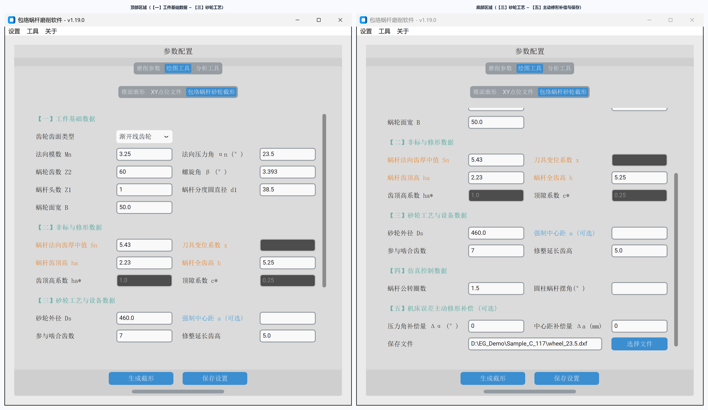
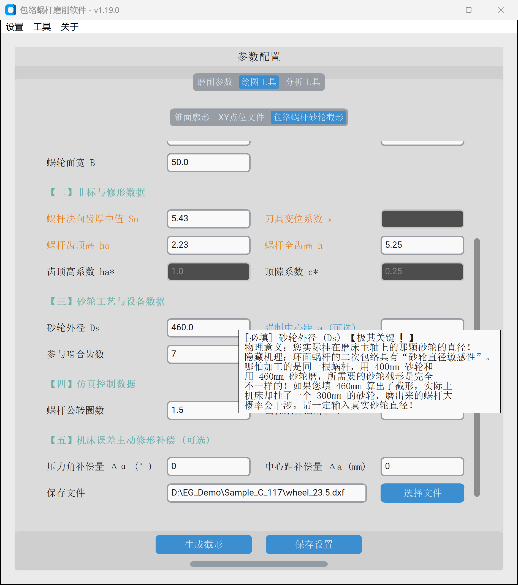
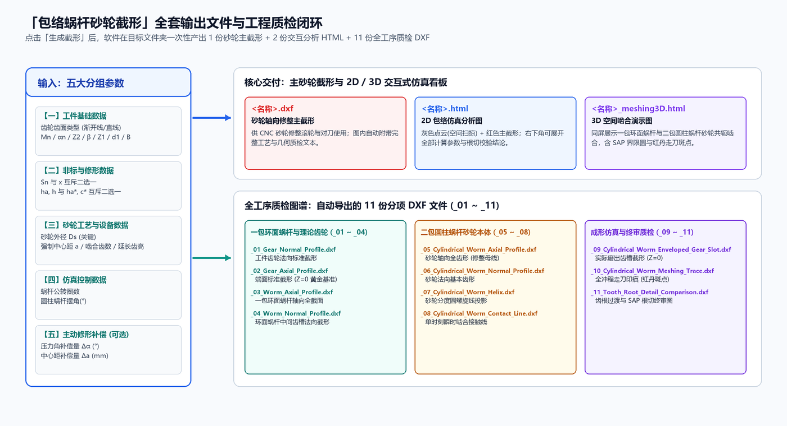
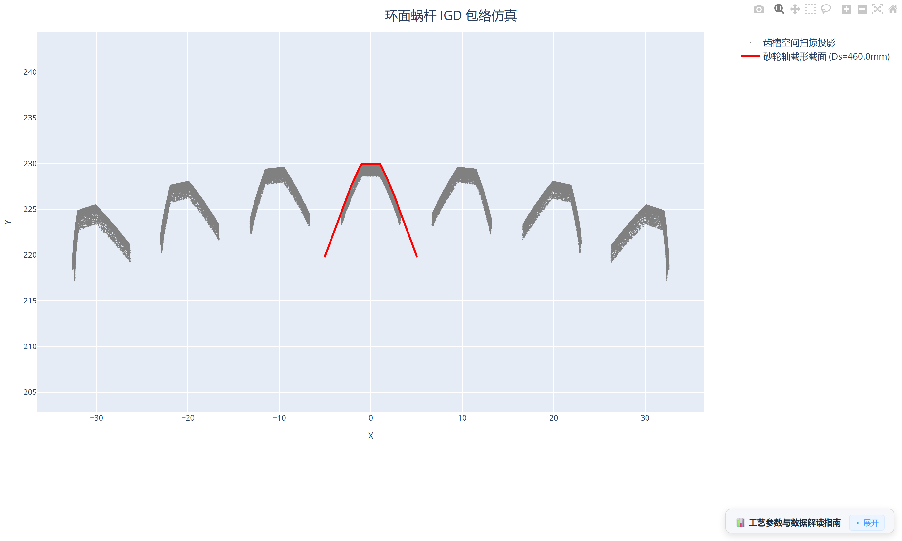
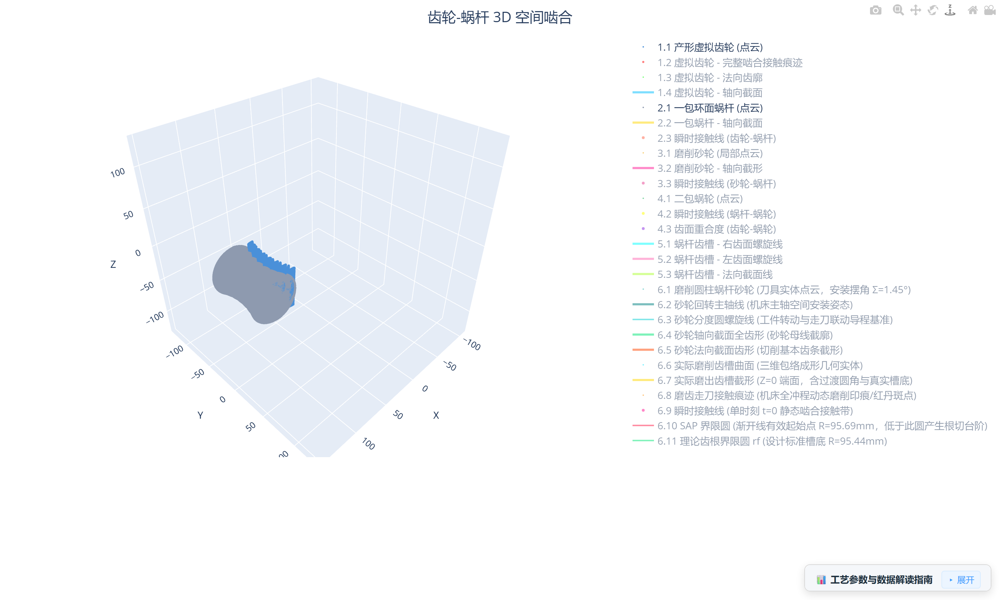

# 3.3 包络蜗杆砂轮截形

**`包络蜗杆砂轮截形`** 是 **EnveloGrinding** 的核心设计仿真模块。只需输入齿轮与蜗杆设计参数，即可通过空间二次包络微分几何求解：
- 满足当前实际砂轮外径 `Ds` 的**精确砂轮修整截形**；
- 一包环面蜗杆与二包圆柱蜗杆砂轮的 **2D/3D 共轭啮合交互看板**；
- 面向车削、修整滚轮与三坐标终审质检的 **11 份全工序分项 DXF 图纸**。

> **悬停提示功能**：将鼠标指针停留在参数名称或输入框上方，右侧立即弹出图文/文字说明卡片，解释该参数的物理意义、推荐取值与隐藏工艺机理（如 **`砂轮外径 Ds`** 的“砂轮直径敏感性”）。

---

## 一、五大分组 22 项参数详解

### 【一】工件基础数据（8 项）

| 参数名称 | 示例值 (`Sample_C_117`) | 物理意义与设置要点 |
| :--- | :---: | :--- |
| **`齿轮齿面类型`** | `渐开线齿轮` | 可选 **`渐开线齿轮`**（标准渐开线齿面）或 **`直线齿面齿轮`**（梯形直齿面，压力角恒定）。 |
| **`法向模数 Mn`** | `3.25` mm | 齿轮/蜗杆基准大小参数，严格按图纸输入。 |
| **`法向压力角 αn (°)`** | `23.5` ° | 决定齿面陡峭程度；常规为 `20°`，重载环面蜗杆常用 `22.5°` / `23.5°` / `28.9°`。 |
| **`蜗轮齿数 Z2`** | `60` | 与蜗杆啮合的配对蜗轮齿数（即虚拟产形刀具齿数）。 |
| **`螺旋角 β (°)`** | `3.393` ° | 蜗轮分度圆螺旋角（通常等于蜗杆喉部导程角）；直齿（如 `Sample_A_110`）填 `0`；软件内部自动用其推导砂轮安装倾角 $\gamma_w$。 |
| **`蜗杆头数 Z1`** | `1` | 蜗杆螺纹头数；与 `Z2` 共同决定传动比 $i = Z_2 / Z_1$。 |
| **`蜗杆分度圆直径 d1`** | `38.5` mm | 蜗杆喉部（最细处）基准分度圆直径。 |
| **`蜗轮面宽 B`** | `50.0` mm | 虚拟产形刀具沿轴向参与包络的宽度；建议取中心距的 `0.4 ~ 0.6` 倍（常用 `34 ~ 50 mm`），保证包络曲线不断裂即可。 |

### 【二】非标与修形数据（两对互斥二选一）

软件界面会自动高亮并**互斥灰显**以下两组参数：

| 互斥组 | 参数 A | 参数 B | 互斥规则与推荐用法 |
| :--- | :--- | :--- | :--- |
| **齿厚控制组** | **`蜗杆法向齿厚中值 Sn`**（如 `5.43`） | **`刀具变位系数 x`**（留空） | 输入 `Sn` 时自动禁用 `x`，软件逆向反算虚拟刀具变位系数（为使蜗杆齿留厚，$x$ 常为负值，属正常现象）；若已知 $x$ 也可留空 `Sn` 直接填入 $x$。 |
| **齿深控制组** | **`蜗杆齿顶高 ha`**（`2.23`） **`蜗杆全齿高 h`**（`5.25`） | **`齿顶高系数 ha*`**（`1.0`） **`顶隙系数 c*`**（`0.25`） | 填入图纸绝对深度 `ha` 与 `h` 后，自动禁用标准系数 `ha*` / `c*`；若图纸未标注绝对深度，留空 `ha`、`h` 即可按 `ha*`、`c*` 乘以模数自动推导。 |

### 【三】砂轮工艺与设备数据（4 项）

| 参数名称 | 示例值 (`Sample_C_117`) | 工程作用与工艺分水岭 |
| :--- | :---: | :--- |
| **`砂轮外径 Ds`** | `460.0` mm | **极其关键**：环面蜗杆二次包络对砂轮直径高度敏感，必须按机台实际挂装砂轮外径填写，否则易导致实际磨削干涉。 |
| **`强制中心距 a (可选)`** | 留空 | 留空时按标准公式 $a = d_1/2 + r_2$ 计算；若采用变位中心距，请按图纸强行指定。 |
| **`参与啮合齿数`** | `7` | 控制虚拟齿轮同时参与包络的齿数（常用 `5` 或 `7`），记录最外侧齿扫掠宽化边界以生成砂轮根部“防干涉倒角”。 |
| **`修整延长齿高`** | `5.0` mm | **工艺路线分水岭**： • **`0.0`**：保留多齿包络防干涉倒角，机床走标准联动即可防干涉； • **`> 0`（如 `5.0`）**：切掉防干涉倒角沿纯 V 形主直线拉长，砂轮易修整，但加工两端时需额外编入 `Z/C` 轴修缘减薄动作。 |

### 【四】仿真控制数据（2 项）

- **`蜗杆公转圈数`**：默认 `1.5`，控制虚拟刀具沿蜗杆轴向扫掠范围（若点云左右两端未完全包络全齿宽，可增至 `2.0`）。
- **`圆柱蜗杆摆角(°)`**：留空时软件自动按公式 $\Sigma = \gamma_1 - \beta$ 匹配计算普通圆柱蜗杆安装摆角；如需指定特定机床偏摆角，可直接填入度数。

### 【五】机床误差主动修形补偿 (可选)（2 项）

- **`压力角补偿量 Δα (°)`**：**调控接触斑点上下位置**
  - 输入**正值**（如 `+0.15`）：解决**蜗杆齿顶干涉**，使砂轮根部变胖，把接触斑点向齿根方向推；
  - 输入**负值**（如 `-0.15`）：解决**蜗杆齿根干涉**，把斑点向齿顶方向移动。
- **`中心距补偿量 Δa (mm)`**：**全齿面鼓形修缘**
  - 输入**负值**（如 `-0.2`）：使砂轮整体变胖，在标准中心距磨削时同时修薄蜗杆齿顶与齿根，将边缘扩散斑点收缩聚焦到齿面中心。

---

## 二、全套输出文件与 2D / 3D 交互图表

点击 **`生成截形`** 后，软件一次产出 **1 份砂轮主截形 + 2 份交互 HTML + 11 份质检 DXF**：

### 1. 2D 包络仿真图（`<名称>.html`）

- **灰色点云**：所有参与啮合齿面在砂轮轴截面的空间扫掠投影；
- **红色包络线**：最终提取的外圆磨削砂轮轴向截形曲线；
- **右下角折叠卡片**：点击 **`▸ 展开`** 可核对完整基本参数、圆柱蜗杆共轭摆角 $\Sigma$、实际磨出槽底直径 $d_f'$ 与理论根圆偏差、有效渐开线起始直径 $d_{\text{sap}}$ 及根切评估结论。

### 2. 3D 空间啮合图（`<名称>_meshing3D.html`）

默认显示一包环面蜗杆、虚拟产形齿轮与啮合接触线；点击右侧图例 **`6.1` ~ `6.12`** 可逐层开关普通圆柱砂轮实体、回转主轴、**`6.7 实际磨出齿槽截形 (Z=0 端面)`**、**`6.8 磨齿走刀接触痕迹（红丹着色斑点）`** 以及 **`6.10 SAP 界限圆`** / **`6.11 理论齿根界限圆 rf`**。

### 3. 自动导出的 11 份全工序质检 DXF 清单

| 序号与文件名后缀 | 所属工步 | 核心物理意义与质检用途 |
| :--- | :---: | :--- |
| `_01_Gear_Normal_Profile.dxf` | 一包理论基准 | 工件齿轮单齿法向标准截形，用于法向基本齿条精度比对 |
| `_02_Gear_Axial_Profile.dxf` | 一包理论基准 | 工件端面（`Z=0`）标准设计截形，**齿形质检黄金基准线** |
| `_03_Worm_Axial_Profile.dxf` | 一包环面蜗杆 | 一包环面蜗杆主轴截面上下双侧完整齿廓 |
| `_04_Worm_Normal_Profile.dxf` | 一包环面蜗杆 | 环面蜗杆喉部中间齿槽沿螺旋槽法向截切轮廓 |
| `_05_Cylindrical_Worm_Axial_Profile.dxf` | 二包砂轮本体 | 普通圆柱蜗杆砂轮轴截母线（**CNC 金刚石修整滚轮母线**） |
| `_06_Cylindrical_Worm_Normal_Profile.dxf` | 二包砂轮本体 | 圆柱蜗杆砂轮沿螺旋槽法向基本梯形截形 |
| `_07_Cylindrical_Worm_Helix.dxf` | 二包砂轮本体 | 砂轮分度圆螺旋线端面投影（校验电子齿轮箱联动比） |
| `_08_Cylindrical_Worm_Contact_Line.dxf` | 二包砂轮本体 | 单时刻（$t=0$）砂轮与工件瞬时相切接触线投影 |
| `_09_Cylindrical_Worm_Enveloped_Gear_Slot.dxf` | 成形与终审 | 实际包络磨出的 `Z=0` 端面齿槽实体截形（直接叠加 `_02` 比对） |
| `_10_Cylindrical_Worm_Meshing_Trace.dxf` | 成形与终审 | 全冲程动态走刀切削印痕（相当于现场红丹着色检验接触斑点） |
| `_11_Tooth_Root_Detail_Comparison.dxf` | 成形与终审 | 同图叠加理论齿廓、实际磨出齿形、**SAP 界限圆**与**理论根圆** |

> **终审质检两大判读法则（内置于 `_11` DXF 文本注释中）**：
> 1. **根切台阶判定**：若实际成形轮廓在进入 `SAP 界限圆` 之前已向内凹陷变细，说明存在严重根切台阶（Undercut）；
> 2. **切深与装配干涉判定**：实际槽底与理论根圆平齐（偏差 `0.00 mm`）则切深标准；高于理论根圆说明槽底偏浅，装配时配对齿轮齿顶有撞底顶死风险。
