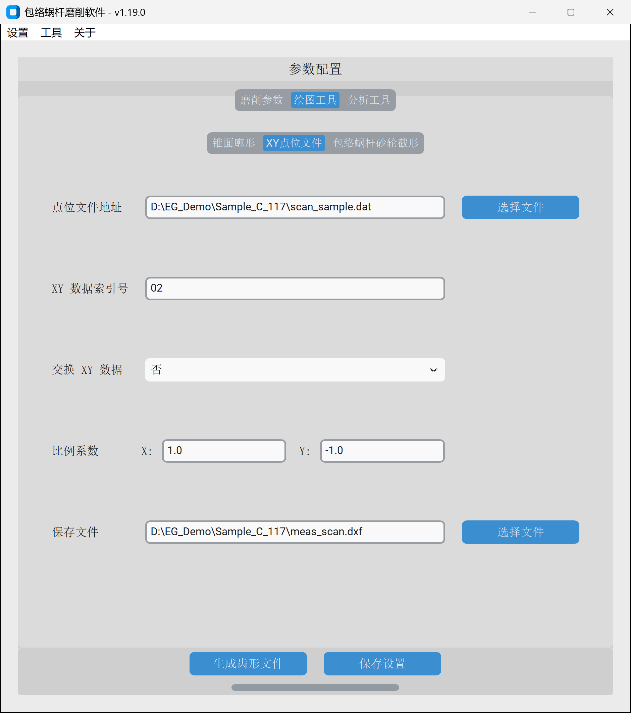
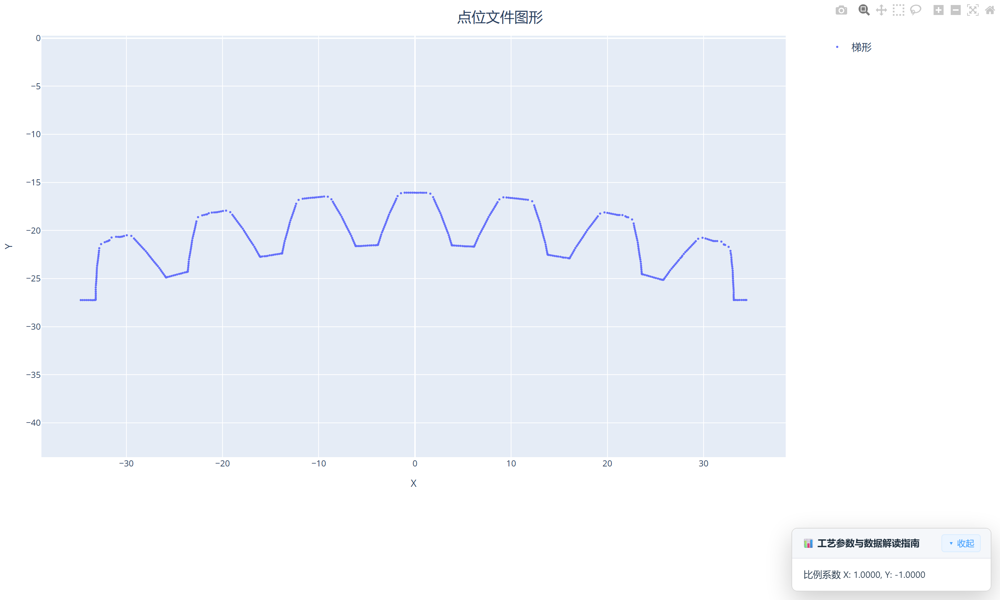

# 3.2 XY点位文件

**`XY点位文件`** 用于将三坐标测量机（CMM）、轮廓仪导出的 `.txt` / `.dat` 文本坐标批量转换为标准 `.dxf` 曲线和交互预览 `.html`，常用于实测蜗杆轴向截面轮廓还原与后续误差分析。

---

## 一、参数逐项说明

### 1. 点位文件地址

- 点击 **`选择文件`** 时，软件先弹出选择类型询问框：
  - 选 **“是”**：选择单个 `.txt` 或 `.dat` 点位文件；
  - 选 **“否”**：选择一个文件夹，自动合并读取目录下全部 `.dat` 文件。
- **自动过滤非坐标行**：若文件开头包含 <code>&#36;ELE (...)</code>、表头说明或分隔线，软件会自动识别跳过，只解析有效数值列。

### 2. XY 数据索引号

- **默认值**：`01`（`0~99` 两位数字） ｜ **示例值（实测扫描数据）**：`02`
- **含义**：指定每行被分隔符（逗号、空格、制表符等）拆开后，哪两列分别作为 `X` 和 `Y` 坐标（从 `0` 开始编号）。
- **实测示例**：扫描数据每行格式如下（第 `0` 列为轴向位置 `X`，第 `1` 列为 `Y` 跳动，第 `2` 列为径向高度 `Z`），因此填写 **`02`** 即提取第 `0` 列与第 `2` 列：

<pre><code>&#36;ELE (NAM=扫描1, TYP=APT, FLD=(X,Y,Z,U,V,W,A)
-34.735731,0.000192,27.235942,0.018324,0.000000,0.999832,0.000000
-34.531578,-0.000607,27.232300,0.010401,0.000000,0.999946,0.000000
...</code></pre>

### 3. 交换 XY 数据

- **可选项**：`否`（默认） / `是`
- **含义**：选择 **`是`** 时将解析出的第一列作为 `Y`、第二列作为 `X`（等价于对调索引号两数字）。

### 4. 比例系数（`X:` / `Y:`）

- **默认值**：`X: 1`、`Y: 1` ｜ **示例值**：`X: 1.0`、`Y: -1.0`
- **含义**：分别乘以所有点的 `X` 与 `Y` 坐标。填入 **`-1.0`** 可一键完成轴镜像翻转（例如将探针向上扫描的外轮廓翻转为与砂轮/槽形一致的方向）。

### 5. 保存文件

- 指定输出 `.dxf` 路径，软件会在该 DXF 中附加记录所使用的 `比例系数 X / Y` 文本注释，并在同目录生成同名 `.html` 交互图。

---

## 二、真实实测扫描数据转换效果

下图为使用真实测绘点云（共 `606` 个有效坐标点，索引 `02`，`X=1.0, Y=-1.0`）点击 **`生成齿形文件`** 后生成的交互图表（右下角卡片自动展示比例系数）：

