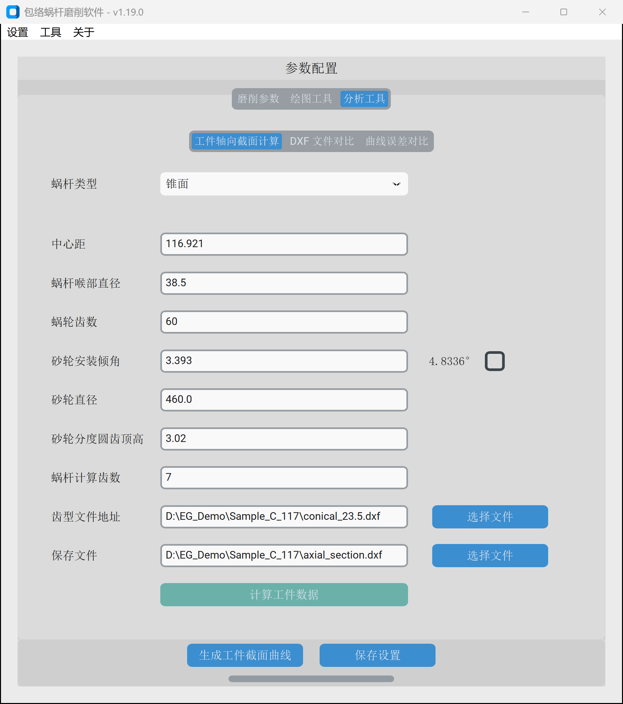
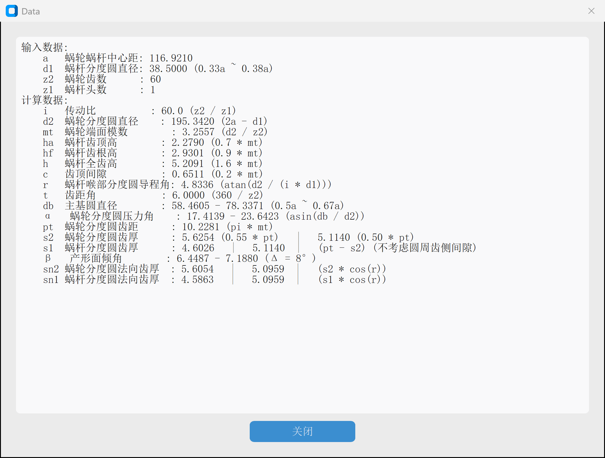
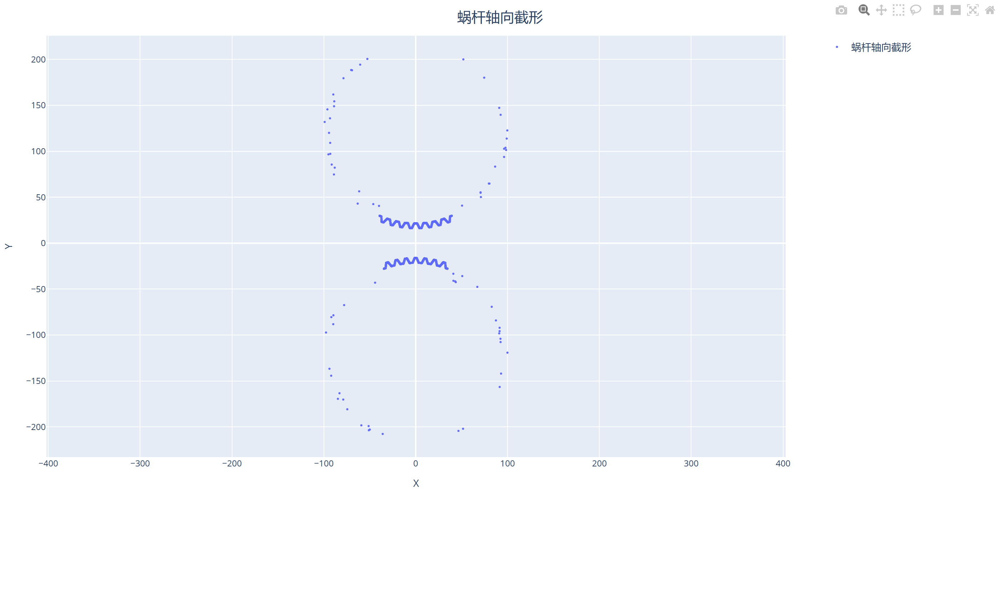
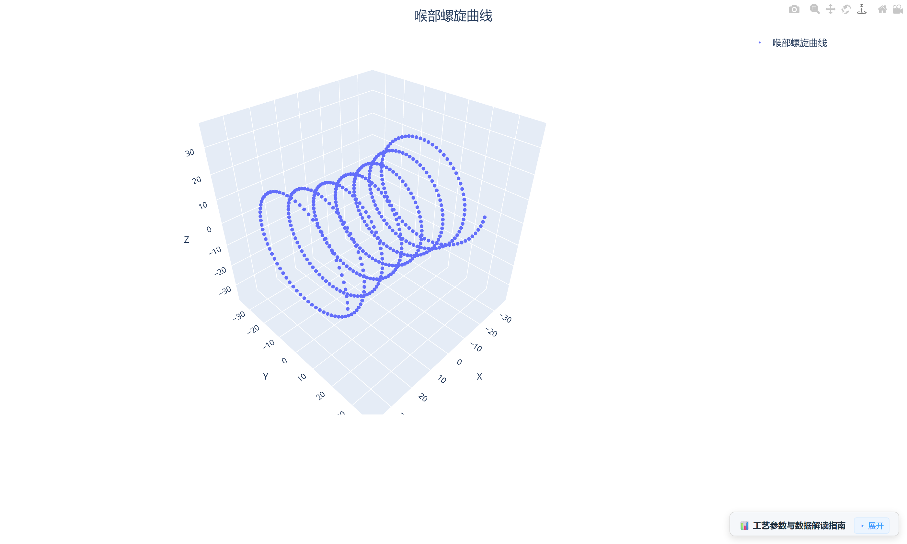

# 4.1 工件轴向截面计算

**`工件轴向截面计算`** 由输入的砂轮截形 `.dxf` 模拟磨削运动，计算包络蜗杆轴向截面理论轮廓与喉部空间螺旋线，并提供独立的一键 **`计算工件数据`** 速算窗口。

---

## 一、输入参数说明

| 参数名称 | 示例值 (`Sample_C_117`) | 说明与条件显隐 |
| :--- | :---: | :--- |
| **`蜗杆类型`** | `锥面` | 选 **`平面`** 时自动展开 **`偏移角`**、**`偏移距离`**、**`中心偏移角度`**（默认 `100`）；选 **`锥面`** 时自动隐藏。 |
| **`中心距`** | `116.921` mm | 蜗轮蜗杆理论中心距 $a$。 |
| **`蜗杆喉部直径`** | `38.5` mm | 蜗杆喉部基准分度圆直径 $d_1$。 |
| **`蜗轮齿数`** | `60` | 配对蜗轮齿数 $Z_2$。 |
| **`砂轮安装倾角`** | `3.393` ° | 砂轮安装角；右侧实时计算标准喉部分度圆导程角（如 `4.8336°`），勾选复选框可自动回填。 |
| **`砂轮直径`** | `460.0` mm | 当前用于模拟切削的砂轮直径。 |
| **`砂轮分度圆齿顶高`** | `3.02` mm | 必须与 **`齿型文件地址`** 所选砂轮截形（如 `锥面廓形` 中的 **`中径齿顶高`**）保持一致。 |
| **`蜗杆计算齿数`** | `7` | 模拟计算的蜗杆齿数；齿数越多越利于分析两侧边缘齿误差，但计算耗时略增。 |
| **`齿型文件地址`** | `conical_23.5.dxf` | 点击 **`选择文件`** 选入砂轮截面 `.dxf` 文件。 |
| **`保存文件`** | `axial_section.dxf` | 指定生成的理论蜗杆轴向截形 `.dxf` 输出路径。 |

---

## 二、快速辅助功能：`计算工件数据`

点击青绿色按钮 **`计算工件数据`**，无需等待仿真即可秒级弹出完整传动与齿形几何参考表（以下为 `Sample_C_117` 真实计算窗口与数值）：

- **核心自动推导公式**：
  - 蜗轮分度圆直径 $d_2 = 2a - d_1 = 195.3420\text{ mm}$，端面模数 $m_t = d_2 / Z_2 = 3.2557\text{ mm}$；
  - 推荐齿顶高 $h_a = 0.7 m_t$、齿根高 $h_f = 0.9 m_t$、全齿高 $h = 1.6 m_t$、顶隙 $c = 0.2 m_t$；
  - 主基圆范围 $d_b = 0.5a \sim 0.67a$ 及对应分度圆压力角 $\alpha = \arcsin(d_b / d_2)$、产形面倾角 $\beta$、蜗轮/蜗杆齿厚参考范围。

---

## 三、点击 `生成工件截面曲线` 的输出结果

点击底部 **`生成工件截面曲线`** 后，软件在目标目录同时产出 3 个文件：

1. **`<名称>.dxf` & `<名称>.html`（2D 蜗杆轴向截形）**：包含 `7` 个工作齿槽完整轴向投影（`Sample_C_117` 共 14,837 个离散点）与闭合过渡包络弧。

2. **`<名称>-helix-3d.html`（3D 喉部螺旋曲线）**：展示提取的喉部空间螺旋滚道曲线，并在右下角信息卡附加 **`模拟滚道计算`** 拟合出的实际喉部分度圆导程角（`Sample_C_117` 实算拟合结果 `-4.9498°`，即导程角绝对值约 `4.95°`）。

