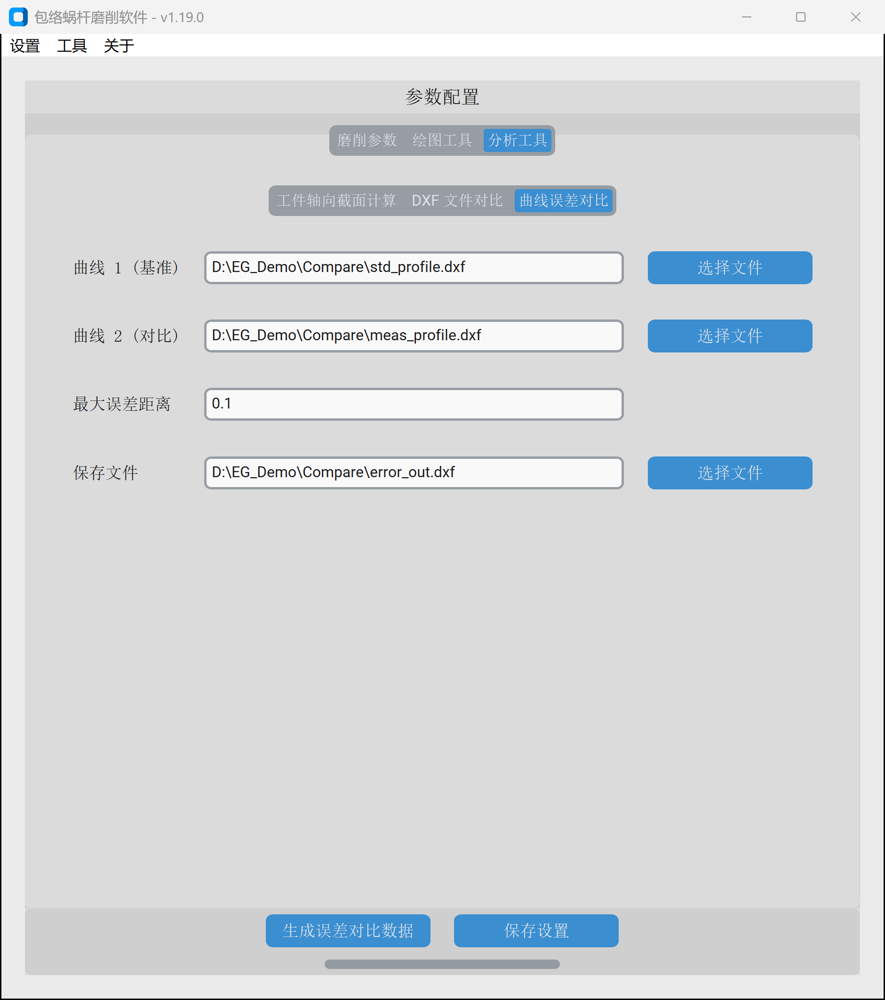
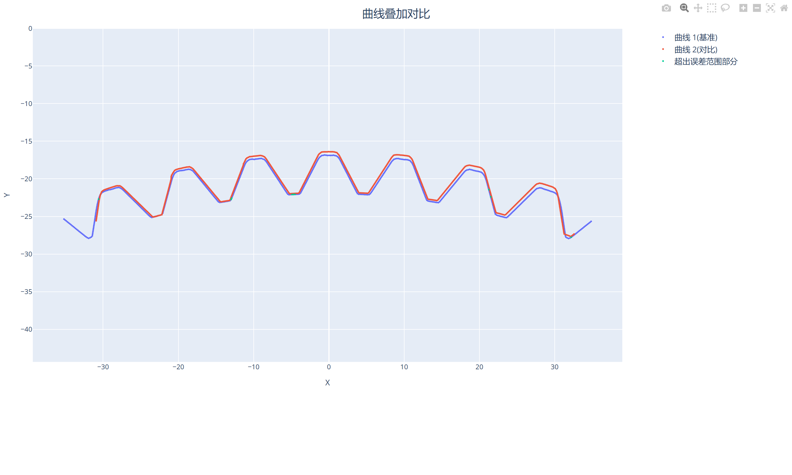
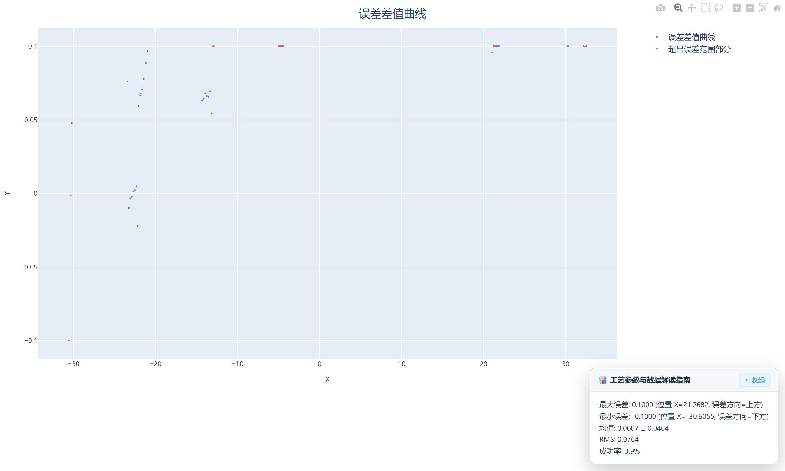

# 4.3 曲线误差对比

**`曲线误差对比`** 在 **`DXF 文件对比`** 定性观察的基础上，进一步沿基准曲线法线方向定量计算两条曲线之间的逐点偏差，自动统计均值、标准差、RMS 均方根误差并高亮超限点区。

---

## 一、参数说明与核心算法逻辑

| 参数名称 | 说明与设置建议 |
| :--- | :--- |
| **`曲线 1 (基准)`** | 标准件或理论设计 `.dxf` 曲线（例如 `std_profile.dxf`）。软件对其沿弧长按 `0.005 mm` 重采样。 |
| **`曲线 2 (对比)`** | 实际试磨或测绘 `.dxf` 曲线（例如 `meas_profile.dxf`）。 |
| **`最大误差距离`** | 沿基准曲线每一点法线方向搜索对比曲线交点的最大允许范围（界面默认 `0.5 mm`，示例设 `0.1 mm`）。 • 设置原则：**在能覆盖实际最大偏移的前提下尽量取小**，避免跨齿误匹配到相邻齿面；若设置过小（如偏移达 `0.3 mm` 时仅设 `0.1 mm`），大量点会被判为超限从而降低有效 `成功率`。 |
| **`保存文件`** | 选择基准路径后，软件会在同目录生成 `<文件名>-differences.dxf`、`<文件名>-differences.html` 与 `<文件名>-curve-compare.html`。 |

---

## 二、误差方向符号约定

- **正误差（`上方`）**：`曲线 2 (对比)` 位于 `曲线 1 (基准)` 的 **Y 轴正向侧**；
- **负误差（`下方`）**：`曲线 2 (对比)` 位于 `曲线 1 (基准)` 的 **Y 轴负向侧**；
- **超出范围**：超出 **`最大误差距离`** 的点在两张图中均以独立的 **`超出误差范围部分`** 图层标记。

---

## 三、真实数据输出结果解读（`std_profile.dxf` vs `meas_profile.dxf`）

### 1. 曲线叠加对比（`*-curve-compare.html`）

由图可见对比曲线（红色）整体略高于基准曲线（蓝色），且基准曲线两侧比实测曲线更长：

### 2. 误差差值曲线与统计卡片（`*-differences.html`）

当 **`最大误差距离`** 设为 `0.1 mm` 时，真实统计卡片与分布如下（有效范围外出现红色超限点）：

- **实时统计指标**：
  - `最大误差`: `0.1000`（位置 `X=21.2682`，误差方向=`上方`）
  - `最小误差`: `-0.1000`（位置 `X=-30.6055`，误差方向=`下方`）
  - `均值`: `0.0607 ± 0.0464` ｜ `RMS`: `0.0764` ｜ `成功率`: `3.9%`
- **工程调优提示**：当界面出现较高比例红点或较低 **`成功率`** 时，表明工件存在整体偏置或余量差超过当前阈值；将 **`最大误差距离`** 放宽至 `0.5` 或 `0.8 mm` 即可纳入完整偏差带（本组实测数据放宽至 `0.8 mm` 时，有效 `成功率` 提升至 `31.6%`，测得整体平均偏移 `+0.2696 mm`、RMS `0.3097 mm`）。
