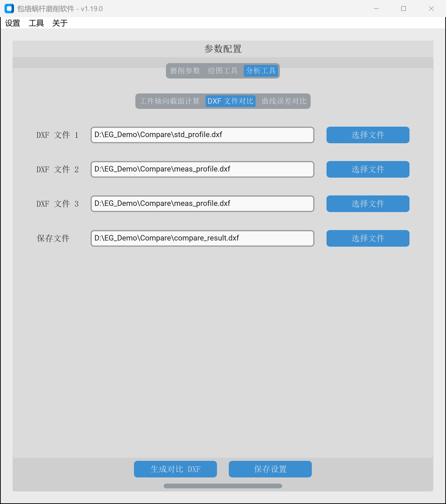
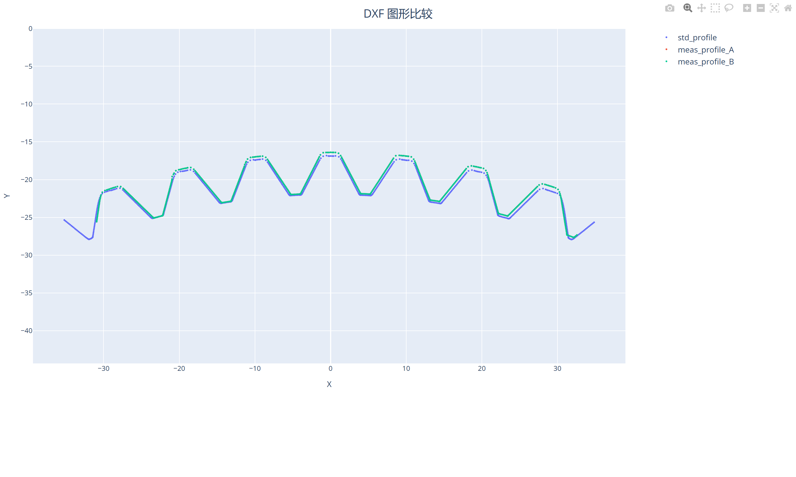

# 4.2 DXF 文件对比

**`DXF 文件对比`** 用于将 2 至 3 份 `.dxf` 曲线文件（例如理论截面与多次试磨实测截形）叠放在同一坐标系下，快速肉眼判别轮廓偏移、齿宽差与左右不对称性。

---

## 一、参数与操作说明

| 界面项目 | 说明 |
| :--- | :--- |
| **`DXF 文件 1`** | 输入第一份曲线 `.dxf`（通常选标准件测绘或理论轴向截形 `std_profile.dxf`）。 |
| **`DXF 文件 2`** | 输入第二份曲线 `.dxf`（例如实际磨削测量曲线 `meas_profile.dxf`）。 |
| **`DXF 文件 3`** | 输入第三份曲线 `.dxf`；**若只有两个文件需要对比，可将其中一个文件同时填入第二、三框**。 |
| **`保存文件`** | 指定合并后的 DXF 文件路径（如 `compare_result.dxf`）。 |

---

## 二、输出结果与交互预览

点击 **`生成对比 DXF`** 后，软件输出：
- 合并叠加的 `.dxf` 文件；
- 同目录的 `<文件名>-plot.html` 交互对比图（按不同颜色区分三条曲线，支持滚轮缩放局部齿面与悬停读数）：

