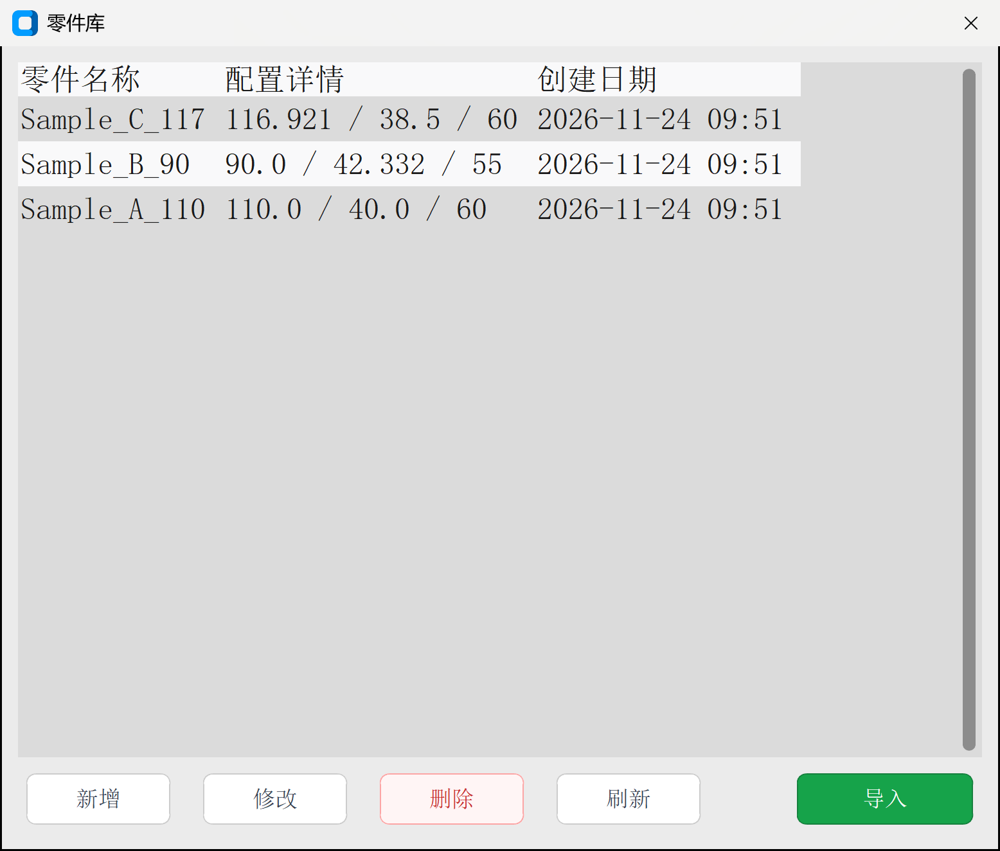

# 5.1 零件库管理指南

**`零件库`** 用于集中归档和复用历史加工过的环面蜗杆工艺方案。点击顶部菜单 **`工具` $\rightarrow$ `零件库`** 即可打开独立管理窗口，避免在不同型号工件切换时逐页手工重录参数。



---

## 一、窗口结构与排序功能

**`零件库`** 窗口由上方三列数据表格与底部五枚操作按钮组成（无单独搜索栏或行内按钮）：

| 列标题 | 显示内容 | 排序与交互说明 |
| :--- | :--- | :--- |
| **`零件名称`** | 工件档案文件夹名称（如 `Sample_C_117`） | 点击列头可切换按名称升序 / 降序排列 |
| **`配置详情`** | 自动从零件目录内读取并汇总核心参数摘要（`中心距 / 蜗杆喉部直径 / 蜗轮齿数`） | 用于快速辨识各规格，不支持点击排序 |
| **`创建日期`** | 零件文件夹创建时间戳（精确到分钟） | 点击列头可切换按时间先后升序 / 降序排列 |

- 点击列表中的任意一行即可高亮选中该零件，随后配合底部按钮执行重命名、删除或导入。

---

## 二、五枚底部操作按钮详解

| 按钮名称 | 功能作用 | 实操步骤与注意事项 |
| :--- | :--- | :--- |
| **`新增`** | 将当前已保存的工作配置归档为新零件 | 1. 建议先在主界面点击右下角 **`保存设置`**，确保全部最新输入已落盘；<br>2. 点击 **`新增`**，在弹窗中输入合法零件名并确认；<br>3. 软件将当前三份工作配置文件复制进新零件目录并高亮选中。 |
| **`修改`** | **仅用于重命名**当前选中的零件名称 | 1. 选中目标行后点击 **`修改`**，在 **`修改零件名称`** 弹窗中输入新名称；<br>2. 若需更新已有零件的参数内容，请先 **`导入`** 并在主界面改动后 **`保存设置`**，再删除旧档重新 **`新增`**（或另存新名）。 |
| **`删除`** | 永久移除选中的零件档案 | 选中目标行后点击 **`删除`**，在确认提示框点击确认即可删除对应磁盘目录；删除前请确认不再追溯历史程序。 |
| **`刷新`** | 重新扫描零件库目录并刷新列表 | 当您在系统文件管理器中手工拷入或整理了外部零件文件夹后，点击 **`刷新`** 立即同步显示。 |
| **`导入`**（右侧绿色） | 用选中零件的全套配置覆盖当前主界面 | 1. 选中目标行后点击绿色 **`导入`** 按钮并确认；<br>2. 软件校验零件目录完整性后，将其配置写回当前工作区并自动刷新全软件 9 个子功能页（若目录缺少任一配置文件将提示报错）。 |

---

## 三、零件命名规范与校验规则

点击 **`新增`** 或 **`修改`** 提交名称时，软件按以下规则严格校验（支持按 `Enter` 确认或 `Esc` 取消）：

| 校验项目 | 规则要求 | 建议示例 |
| :--- | :--- | :--- |
| 非空约束 | 零件名称不能为空 | `Sample_C_117` |
| 非法字符限制 | 不允许包含 `\ / : * ? " < > |` | 使用下划线连接，如 `M3_25_Z60_A117` |
| 结尾字符限制 | 不能以英文句点 `.` 结尾 | 避免使用 `Sample.` 等写法 |
| 系统保留名 | 禁止使用 `CON`、`PRN`、`AUX`、`NUL`、`COM1`–`COM9`、`LPT1`–`LPT9` | 建议包含模数与中心距代号 |
| 长度上限 | 最长不超过 `100` 个字符 | 建议控制在 `30` 个字符以内 |

> **提示**：建议按“规格代号 + 中心距”（例如 `Sample_C_117`）统一命名；跨设备迁移或技术支持排查前，请先清理含客户全称或内部敏感项目号的档案目录。

---

## 四、本地存储结构与备份迁移

软件在本地配置目录 `~/.eg/`（Windows 系统默认为 `%USERPROFILE%\.eg\`）下维护所有运行配置与零件档案：

```text
~/.eg/
├── eg_config_main.json          # 当前工作区：磨削参数 + 语言设置
├── eg_config_draw.json          # 当前工作区：绘图工具参数
├── eg_config_tool.json          # 当前工作区：分析工具参数
├── eg_license.lic               # 离线数字签名授权文件（若已导入）
├── error.log                    # 异常堆栈日志（排查问题时查看）
└── PartsLibrary/
    ├── Sample_A_110/
    │   ├── eg_config_main.json
    │   ├── eg_config_draw.json
    │   └── eg_config_tool.json
    ├── Sample_B_90/
    └── Sample_C_117/
```

- **单零件完整迁移**：只需将 `PartsLibrary/<零件名称>` 整夹复制到另一台已安装 **EnveloGrinding** 的电脑对应 `~/.eg/PartsLibrary/` 目录，在软件 **`零件库`** 中点击 **`刷新`** 即可直接 **`导入`** 使用。
