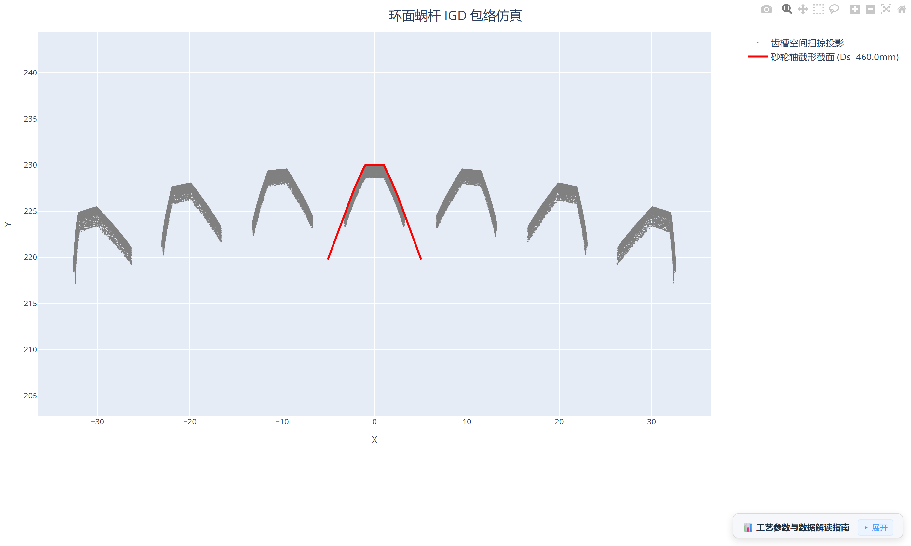
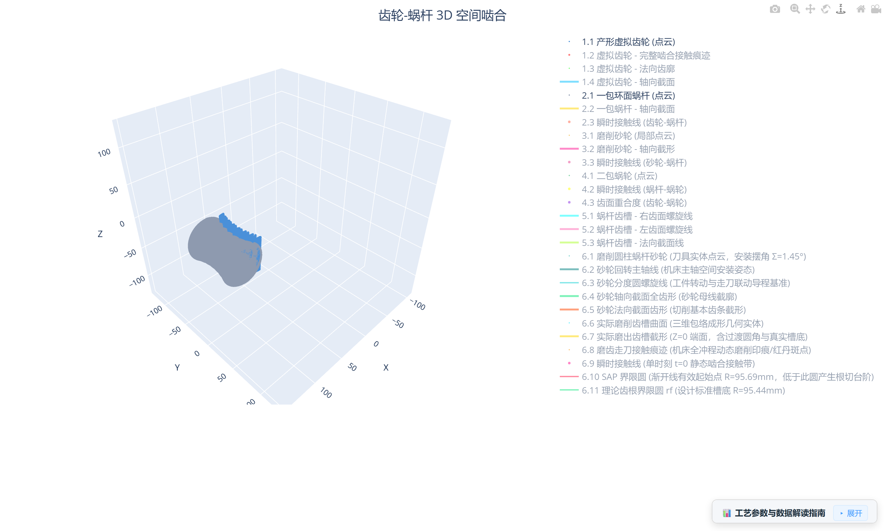
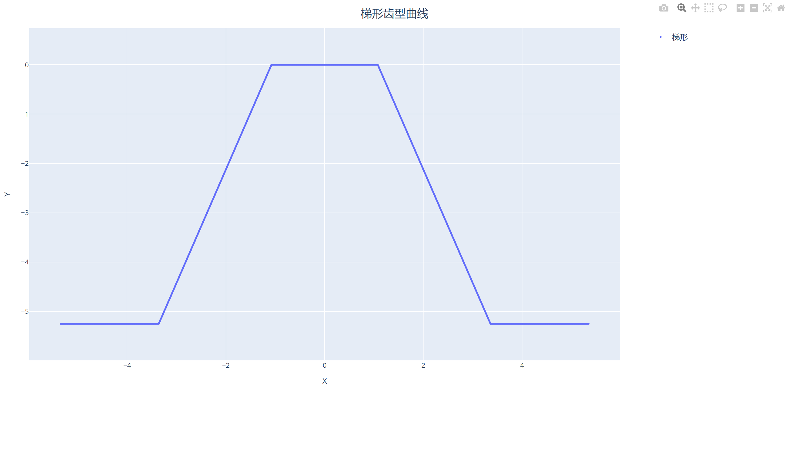
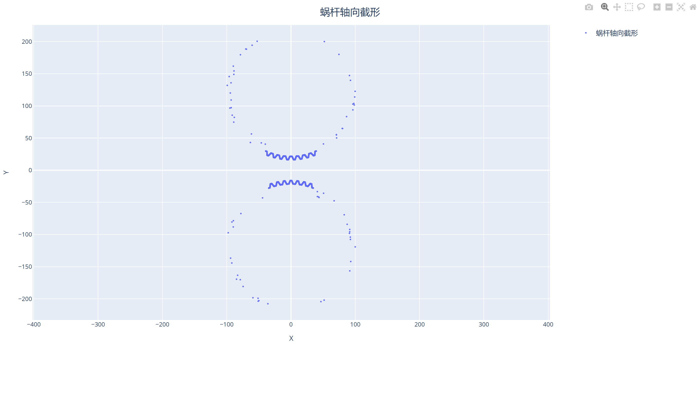
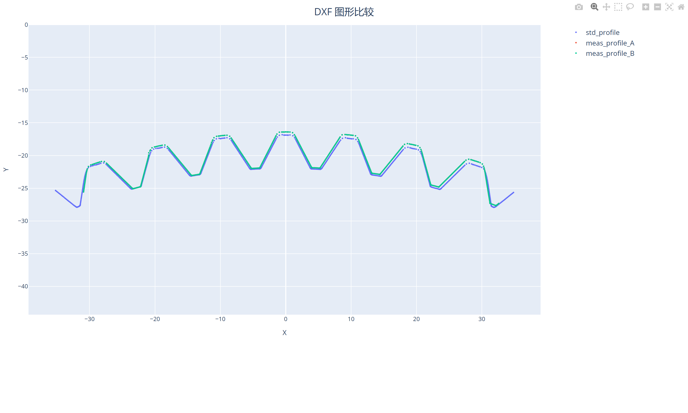
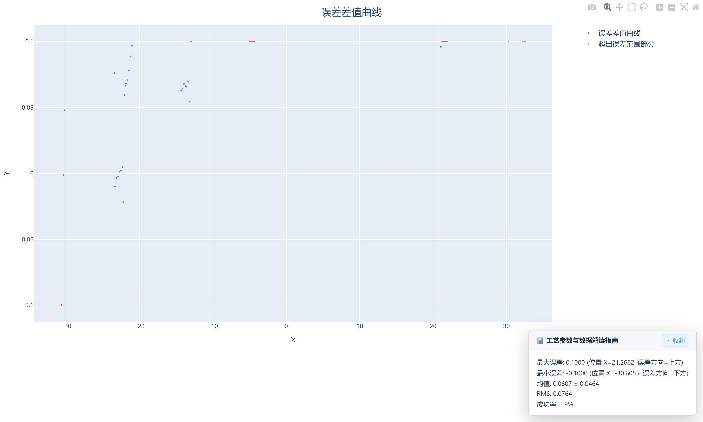

# 6.1 案例一：大压力角渐开线蜗杆全流程加工与检验

本案例以大压力角重载规格 **`Sample_C_117`** 为例，演示如何从 **`工具` $\rightarrow$ `零件库`** 点击 **`导入`** 载入配置开始，依次完成 **包络砂轮截形校验 -> 锥面廓形输出 -> 西门子 NC 代码批量生成 -> 工件轴向截面提取 -> 轮廓定性与法向定量误差检验** 的完整工程闭环。

---

## 一、工件基础参数设定（`Sample_C_117`）

在 **`工具` $\rightarrow$ `零件库`** 中选中 `Sample_C_117` 并点击绿色 **`导入`** 按钮，核心几何与工艺输入自动回填如下：

- **齿轮齿面类型**：`渐开线齿轮`
- **基本几何**：`法向模数 Mn = 3.25 mm`、`法向压力角 αn (°) = 23.5°`、`蜗轮齿数 Z2 = 60`、`螺旋角 β (°) = 3.393°`
- **蜗杆与安装**：`蜗杆头数 Z1 = 1`、`蜗杆分度圆直径 d1 = 38.5 mm`、`蜗轮面宽 B = 50.0 mm`、`蜗杆法向齿厚中值 Sn = 5.43 mm`
- **齿高与仿真**：`蜗杆齿顶高 ha = 2.23 mm`、`蜗杆全齿高 h = 5.25 mm`、`砂轮外径 Ds = 460.0 mm`、`参与啮合齿数 = 7`、`修整延长齿高 = 5.0 mm`、`蜗杆公转圈数 = 1.5`

---

## 二、包络截形与共轭啮合校验

切换至 **`绘图工具` $\rightarrow$ `包络蜗杆砂轮截形`** 页签，保持零补偿基准（`Δa = 0.000 mm`、`Δα = 0.000°`）点击 **`生成截形`**，核对以下实算结果：

| 校验维度 | 实算关键指标 | 工程判定说明 |
| :--- | :--- | :--- |
| 中心距与偏置 | 理论中心距 `a = 116.921 mm`，磨削中心距 `246.230 mm`，砂轮偏置距 `Xc = 129.309 mm` | 确认砂轮回转轴相对齿轮理论中心位置 |
| 产形齿轮与变位 | 分度圆半径 `r2 = 97.671 mm`，基圆半径 `rb = 89.545 mm`，变位系数 `x = -0.1150` | 轻度负变位匹配给定 `Sn = 5.430 mm` |
| 共轭导程匹配 | 蜗杆分度圆导程角 `γ1 = 4.842°`，安装摆动角 `Σ = 1.449°`（`γ1 - β`） | 磨削安装角 `γw = 3.393°` 与螺旋角一致 |
| 根切与顶隙校核 | 理论齿根圆 `df = 190.882 mm`，有效渐开线起始直径 `dsap = 191.382 mm`（`db = 179.091 mm`） | **无根切**，渐开线工作齿侧完整平滑；装配槽底顶隙评估为 **标准匹配** |

---

## 三、锥面廓形输出与砂轮直径序列编程

1. **输出规则砂轮修整廓形**：进入 **`绘图工具` $\rightarrow$ `锥面廓形`** 页签，使用与 `Sample_C_117` 配套的截形参数点击 **`生成齿形文件`**，导出 `conical_23.5.dxf` 与交互式 2D 预览图。
2. **设定磨削参数范围**：回到 **`磨削参数`** 下的 **`基本参数`**、**`高级参数`** 与 **`其他参数`**：
   - 确认 `中心距 = 116.921`、`蜗杆喉部直径 = 38.5`、`蜗轮齿数 = 60`、`砂轮安装倾角 = 3.393`（软件实时提示标准导程角 `4.8336°` 作参考校核）。
   - 设定 `磨削总深度 = 1.0`、`磨削步进 = 0.1`。
   - 设定 `最大砂轮直径 = 460.0`、`最小砂轮直径 = 450.0`、`砂轮直径间隔 = 2.0`。
3. **检查 NC 序列输出**：指定 **`输出程序路径`** 并点击 **`生成代码`** 后，目标目录自动建立 `PC_116_9210` 子文件夹，并一次性产出 `DIA_450_0000.SPF` 至 `DIA_460_0000.SPF` 共 6 份加工程序，其中理论 `Y轴加工位置 = -2.3176 mm`。

---

## 四、工件轴向截面反算与实测双级对比

完成试切或虚拟加工后，在 **`分析工具`** 下依次执行截面反算与轮廓误差对比：

1. **`工件轴向截面计算`**：
   - 输入 `中心距 = 116.921`、`蜗杆喉部直径 = 38.5`、`蜗轮齿数 = 60`，选入砂轮截面 DXF 并点击 **`生成工件截面曲线`**。
   - 软件反算出分度圆直径 `d2 = 195.3420 mm`、端面模数 `mt = 3.2557 mm`，生成含 `14,837` 个点的 2D 轴向轮廓，并在 3D 图中拟合出 `喉部螺旋曲线` 导程角 `-4.9498°`。

2. **`DXF 文件对比`（定性叠加观察）**：
   - 将理论标准轮廓 `std_profile.dxf` 与实测轮廓 `meas_profile.dxf` 叠加在同一坐标系下，快速判别是否存在整体平移偏置、左右齿面不对称或局部凸凹趋势：

3. **`曲线误差对比`（法向定量精度检验）**：
   - 设定 **`曲线 1 (基准) = std_profile.dxf`**、**`曲线 2 (对比) = meas_profile.dxf`** 后点击 **`生成误差对比数据`**：
   - 当 **`最大误差距离 = 0.1 mm`** 时：`均值 = 0.0607 ± 0.0464 mm`，`RMS = 0.0764 mm`，`成功率 = 3.9%`；
   - 放宽 **`最大误差距离 = 0.8 mm`** 观察完整偏差分布时：`均值 = 0.2696 mm`，`RMS = 0.3097 mm`，`成功率 = 31.6%`；结合超差分布区与误差方向（`上方` / `下方`）即可直接反推安装摆角或切深零点补偿量。

