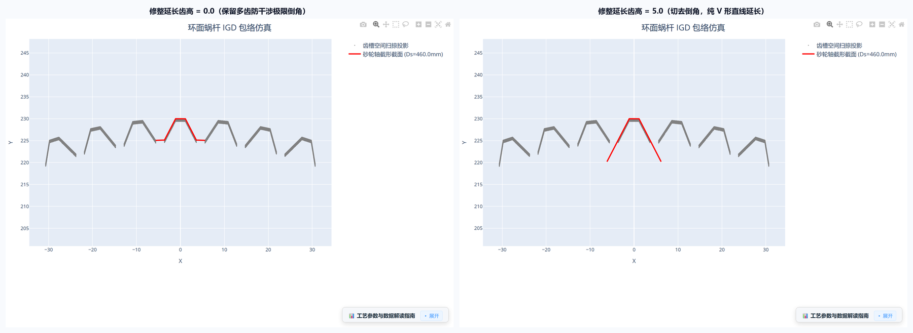

# 6.2 案例二：直线齿面零螺旋角蜗杆截形与修整路线

本案例基于零件库中的直线齿面规格 **`Sample_A_110`**，说明当产形齿轮 `螺旋角 β (°) = 0` 且选用 `直线齿面齿轮` 时，参数配置特征、直线夹角检验项及 **`修整延长齿高`**（`0.0` vs `5.0 mm`）对砂轮修整与机床防干涉路线的工艺影响。

---

## 一、直线齿面与零螺旋角参数特征（`Sample_A_110`）

从 **`工具` $\rightarrow$ `零件库`** 点击 **`导入`** 载入 `Sample_A_110`，其核心区别于渐开线工况的配置如下：

- **齿轮齿面类型**：`直线齿面齿轮`
- **零螺旋角设置**：`螺旋角 β (°) = 0°`、主界面 `砂轮安装倾角 = 0.0°`（虚拟产形轮导程 `pz = ∞` 直齿）
- **基本规格**：`法向模数 Mn = 3.0 mm`、`法向压力角 αn (°) = 28.9°`、`蜗轮齿数 Z2 = 60`、`蜗杆头数 Z1 = 1`
- **中心距与面宽**：`中心距 = 110.0 mm`、`蜗杆分度圆直径 d1 = 40.0 mm`、`蜗轮面宽 B = 34.0 mm`
- **齿厚与齿高**：`蜗杆法向齿厚中值 Sn = 4.1 mm`、`蜗杆齿顶高 ha = 1.85 mm`、`蜗杆全齿高 h = 4.81 mm`、`砂轮外径 Ds = 460.0 mm`、`参与啮合齿数 = 7`

---

## 二、实算结果与直线齿面专属检验项

直线齿面模式下，包络模块除输出常规中心距与变位系数外，还会额外输出**齿轮齿槽实际物理直线夹角**用于现场量具与刀具校对：

| 输出指标 | 实算数值 | 工程含义 |
| :--- | :--- | :--- |
| 理论与磨削中心距 | `a = 110.000 mm`，磨削中心距 `247.040 mm` | 砂轮相对齿轮偏置距 `Xc = 137.040 mm` |
| 虚拟产形轮与变位 | `r2 = 90.000 mm`，`rb = 78.792 mm`，`x = 0.1849` | 正变位匹配给定 `Sn = 4.100 mm` |
| 共轭匹配角 | 导程角 `γ1 = 4.301°`，`β = 0.000°`，`Σ = 4.301°` | 零螺旋角直齿条件下安装摆动角直接等于 `γ1` |
| 根切与顶隙校核 | `df = 176.300 mm`，`dsap = 176.800 mm`（`db = 157.584 mm`） | 良好：无根切，工作齿侧完整平滑；装配顶隙标准匹配 |
| 单侧直线夹角 | 端面（`Z = 0`）与法向截面单侧直线夹角均为 `27.205°` | 单侧直齿齿面相对对称中心线的物理夹角，用于量测校准 |

---

## 三、对比实验：`修整延长齿高 = 0.0` vs `5.0 mm`（工艺路线分水岭）

在同一套 `Sample_A_110` 参数下，分别设置 `修整延长齿高 = 0.0 mm` 与 `5.0 mm` 计算砂轮截形，对照结果如下：

- **工作段几何不变性**：两组计算中的理论中心距（`110.000 mm`）、磨削中心距（`247.040 mm`）、变位系数（`0.1849`）与单侧直线夹角（`27.205°`）完全一致，变更 **`修整延长齿高`** 不会改变中间有效包络工作齿形。
- **路线 A（`修整延长齿高 = 0.0 mm`）——自带防干涉倒角**：
  - 左图可见软件在砂轮齿根边缘保留了由 `7` 齿扫掠自然形成的**防干涉极限倒角**；
  - **机床加工路线**：机床只需按标准四轴联动加工即可，依靠砂轮根部自带倒角自动削薄蜗杆两端齿端，直接实现多齿无干涉啮合。
- **路线 B（`修整延长齿高 = 5.0 mm`）——纯 V 形直线延长**：
  - 右图可见软件切除了防干涉极限倒角，改为沿纯 V 形主直线向下延长 `5.0 mm`；
  - **机床加工路线**：砂轮修整极其简单（全直边），但磨削蜗杆两端时**必须由工艺人员在 CNC 程序中额外增加 Z / C 轴减薄修缘动作**，否则蜗杆两端入口/出口处将发生干涉顶刀。
- **主界面编程联动**：在 **`磨削参数` $\rightarrow$ `基本参数`** 中对应设定 `蜗轮加工角度 = 60.0°`、`砂轮安装倾角 = 0.0°` 与 `中心距 = 110.0` 即可同步导出磨削 `.SPF` 程序。
