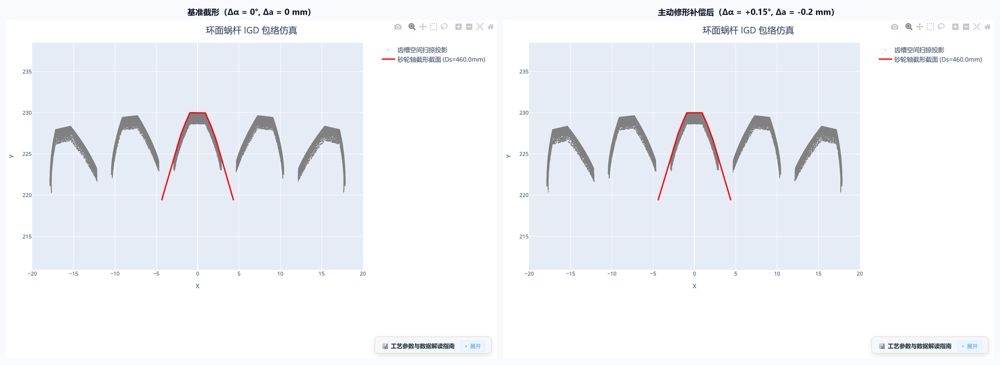

# 6.3 案例三：标准渐开线蜗杆接触斑点主动修形补偿

在实际齿轮副装配跑合中，常出现齿面接触斑点偏高（蜗杆齿顶干涉）、偏低（蜗杆齿根干涉）或载荷向边缘扩散过宽的情况。本案例基于标准 `20°` 压力角规格 **`Sample_B_90`**，对比 **理论基准工况** 与 **主动修形补偿工况（`压力角补偿量 Δα (°) = +0.15°` + `中心距补偿量 Δa (mm) = -0.2 mm`）** 的定量变化。

---

## 一、基准工件参数（`Sample_B_90`）

从 **`工具` $\rightarrow$ `零件库`** 点击 **`导入`** 载入 `Sample_B_90`（中小模数标准压力角代表件）：

- **齿轮齿面类型**：`渐开线齿轮`
- **基本几何**：`法向模数 Mn = 2.5 mm`、`法向压力角 αn (°) = 20°`、`蜗轮齿数 Z2 = 55`、`螺旋角 β (°) = 2.829°`
- **蜗杆与砂轮**：`蜗杆头数 Z1 = 1`、`蜗杆分度圆直径 d1 = 42.332 mm`、`蜗轮面宽 B = 50.0 mm`、`蜗杆法向齿厚中值 Sn = 3.467 mm`、`蜗杆齿顶高 ha = 2.5 mm`、`蜗杆全齿高 h = 5.625 mm`、`砂轮外径 Ds = 460.0 mm`、`参与啮合齿数 = 5`、`修整延长齿高 = 5.0 mm`
- **基准磨削设置**：`中心距 = 90.0 mm`、`蜗杆喉部直径 = 42.332`、`蜗轮齿数 = 55`、`砂轮安装倾角 = 2.829`

---

## 二、基准 vs 主动修形定量对照表

保持基本模数、齿数与 `Sn = 3.467 mm` 不变，在 **`包络蜗杆砂轮截形`** 最下方 **`【五】机床误差主动修形补偿 (可选)`** 输入 `压力角补偿量 Δα (°) = 0.15` 与 `中心距补偿量 Δa (mm) = -0.2` 后点击 **`生成截形`**，实算差异如下：

| 对比项目 | 理论基准（`Δα=0, Δa=0`） | 主动修形（`Δα=+0.15°, Δa=-0.2 mm`） | 工程意义与变化趋势 |
| :--- | :--- | :--- | :--- |
| 实际加工压力角 | `20.000°` | `20.150°` | 砂轮根部变胖并多切蜗杆齿顶，将接触斑点向下（齿根方向）推动 |
| 实际加工中心距 `a'` | `90.000 mm` | `89.800 mm` | 负向中心距补偿使砂轮整体变胖、对蜗杆齿顶与齿根双向修缘 |
| 磨削中心距（砂轮-蜗杆） | `248.041 mm` | `247.841 mm` | 同步随 `Δa` 减小 `0.200 mm` |
| 产形轮基圆半径 `rb` | `64.673 mm` | `64.611 mm` | 压力角增大导致基圆略微收缩（`db` 由 `129.347` 降至 `129.223 mm`） |
| 变位系数 `x` | `0.2528` | `0.2507` | 为维持目标法向齿厚 `Sn = 3.467 mm`，变位自动微小重算 |
| 实际磨削槽底直径 `df'` | `132.668 mm`（偏差 `+0.000 mm`） | `132.268 mm`（偏差 `-0.400 mm`） | 槽底切深增加，有效渐开线起点 `dsap` 由 `133.168` 下移至 `132.768 mm` |
| 装配槽底顶隙评估 | `标准匹配 (与理论顶隙一致)` | `偏深 (顶隙富余, 需注意齿根弯曲强度)` | 系统自动提示复核齿根弯曲强度与安全余量 |

---

## 三、车间调机与选参实操要点

- **按试切斑点方向选择补偿量**：
  - **解决蜗杆齿顶干涉（斑点偏高）**：输入正的 **`压力角补偿量 Δα (°)`**（如 `+0.15`），使砂轮根部变胖、切去蜗杆齿顶多余材料，将接触斑点向**齿根方向**推；
  - **解决蜗杆齿根干涉（斑点偏低）**：输入负的 **`压力角补偿量 Δα (°)`**（如 `-0.15`），将接触斑点向**齿顶方向**移动；
  - **全齿面鼓形聚焦（消除边缘分散接触）**：输入负的 **`中心距补偿量 Δa (mm)`**（如 `-0.2`），使砂轮整体变胖，磨削时额外切去蜗杆齿顶与齿根形成双向修缘，将边缘斑点强制收缩并聚焦到齿面正中心（极少输入正值）。
- **防根切与强度底线**：施加负向 `Δa` 后，务必检查 2D 图右下角 **`📊 工艺参数与数据解读指南`** 或 `_11` DXF 文本中的 `有效渐开线起始直径 dsap`、`切深偏差` 与 `装配槽底顶隙评估`，确认无根切且齿根弯曲强度满足要求后再下发加工。
- **另存为独立零件方案**：调机验证满意后，先在主界面点击底部 **`保存设置`**，再打开 **`工具` $\rightarrow$ `零件库`** 点击 **`新增`** 另存为独立版本（例如 `Sample_B_90_Crowned`），避免覆盖原始理论基准配置。
