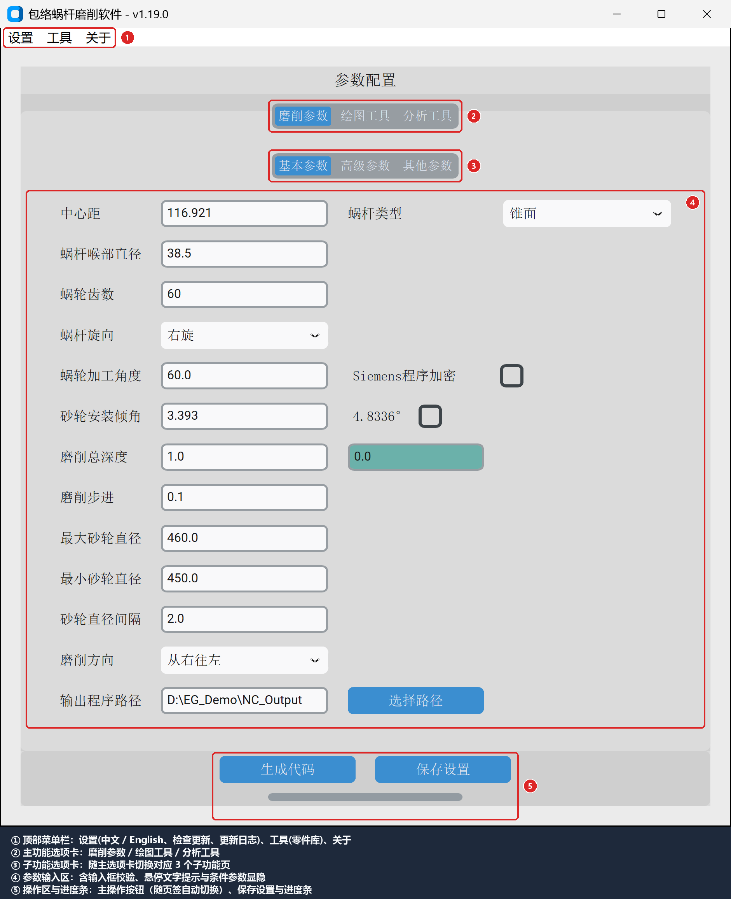

# EnveloGrinding 用户指南

欢迎使用 **EnveloGrinding 包络蜗杆磨削软件（v1.19.0）** 用户指南！

本指南面向**工艺工程师、蜗杆与砂轮设计工程师、数控磨床编程与三坐标检测人员**，以清晰的列表、实机截图与真实脱敏零件算例，助您掌握从包络砂轮截形设计、工件轴向截面仿真、实测误差比对到多轴 CNC 磨削代码生成与零件库管理的完整工作流。

---

## 核心功能速览

- **磨削参数与 CNC 磨削代码生成（`磨削参数`）**
  - 支持 **`锥面`** 与 **`平面`** 两种包络蜗杆类型（选 `平面` 时自动展开 **`磨削面`**、**`偏移角`**、**`偏移距离`**）。
  - 内置 **`蜗杆喉部直径`** 与 **`中心距`** 联动实时计算标准导程角，支持一键复选回填 **`砂轮安装倾角`**。
  - 按 **`最大砂轮直径`** ~ **`最小砂轮直径`** 与 **`砂轮直径间隔`** 批量输出 `PC_xxx/DIA_xxx.SPF` 程序，支持 **`Siemens程序加密`**（生成 `.cpf` 加密程序）及全参数绿色微调补偿框。
- **砂轮截形设计与包络仿真（`绘图工具`）**
  - **`锥面廓形`**：按 **`中径宽`**、**`中径齿顶高`**、**`中径齿底高`** 与左右半角生成带 `2 mm` 延伸线的 1:1 砂轮 DXF 及 2D 交互 HTML。
  - **`XY点位文件`**：支持单文件（`.txt` / `.dat`）或文件夹批量导入，灵活设置 **`XY 数据索引号`**、**`交换 XY 数据`** 与 **`比例系数`**（缩放或镜像）。
  - **`包络蜗杆砂轮截形`**：支持 **`渐开线齿轮`** 与 **`直线齿面齿轮`**，通过 5 大分组 22 项参数与 **`压力角补偿量 Δα (°)`** / **`中心距补偿量 Δa (mm)`** 主动修形，一次输出砂轮主截形 DXF、2D/3D 交互 HTML 及 **`_01` ~ `_11` 共 11 份全工序质检 DXF**。
- **理论轴向截面与实测误差闭环（`分析工具`）**
  - **`工件轴向截面计算`**：由砂轮 DXF 反求蜗杆轴向截面曲线与 3D **`喉部螺旋曲线`**，内置 **`计算工件数据`** 速算核心传动与几何参数。
  - **`DXF 文件对比`**：支持最多 3 份 DXF 曲线叠加合并与交互浏览。
  - **`曲线误差对比`**：沿基准曲线法线方向定量计算偏差分布，自动标出 **`超出误差范围部分`** 并输出均值、RMS 与成功率统计。
- **企业级零件库与三模式授权（`工具 → 零件库` + 多重授权）**
  - **`零件库`**：集中管理工件档案（展示 **`中心距 / 蜗杆喉部直径 / 蜗轮齿数`** 摘要），一键 **`新增`**、**`修改`**、**`删除`**、**`刷新`** 与 **`导入`** 恢复全套三页参数。
  - 支持 **`硬件ID`**（含 **`导入授权文件`** 离线 `.lic`）、**`账户登录`** 与 **`加密狗`**（自动静默启动与实时断狗保护），并支持中英文热切换与在线升级。

---

## 章节导航

| 章节 | 主题 | 核心内容 |
| :---: | :--- | :--- |
| **第 1 章** | **[快速开始](1_getting_started/README.md)** | 安装授权（硬件 ID / 离线 `.lic` / 账户 / 加密狗）、主界面分区与三分钟快速上手 |
| **第 2 章** | **[磨削参数与 NC 代码生成](2_grinding_params/README.md)** | 详解 **`基本参数`**（18 项含条件显隐）、**`高级参数`**（9 项机床几何与对刀基准）与 `.SPF` 代码解读 |
| **第 3 章** | **[绘图工具与砂轮截形设计](3_drawing_tools/README.md)** | 详解 **`锥面廓形`**、**`XY点位文件`** 与 **`包络蜗杆砂轮截形`**（22 项参数及 11 份质检 DXF） |
| **第 4 章** | **[分析工具与精度检验](4_analysis_tools/README.md)** | 详解 **`工件轴向截面计算`**（含 **`计算工件数据`**）、**`DXF 文件对比`** 与 **`曲线误差对比`** |
| **第 5 章** | **[零件库、菜单功能与交互图表](5_parts_library_and_menus/README.md)** | 掌握 **`零件库`** 全操作、菜单栏速查、三 JSON 配置机制与 2D/3D HTML 图表交互技巧 |
| **第 6 章** | **[典型工程实战案例](6_workflows_cases/README.md)** | 大压力角渐开线全流程闭环、直线齿面零螺旋角修整选型、标准渐开线 $\Delta\alpha / \Delta a$ 修形对比 |
| **第 7 章** | **[常见提示与故障排除](7_troubleshooting/README.md)** | 汇总授权与加密狗、代码生成、包络截形、误差统计与 `error.log` 排查方案 |

---

## 系统需求与技术支持

- **运行环境**：Windows 10 / Windows 11（64 位）或 macOS 10.14 及以上（**`Siemens程序加密`** 仅支持 Windows）。
- **硬件建议**：内存 8 GB 及以上，500 MB 以上可用磁盘空间，支持 OpenGL 3.3+ 的显卡（用于流畅浏览 3D 交互 HTML）。
- **官方网站**：[https://eg.niekun.net/](https://eg.niekun.net/)
- **在线手册**：[https://eg-manual.niekun.net/](https://eg-manual.niekun.net/)
- **技术支持邮箱**：[xincore@niekun.net](mailto:xincore@niekun.net)
